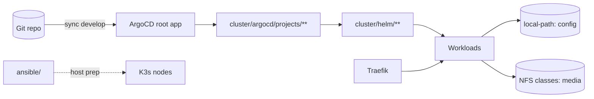
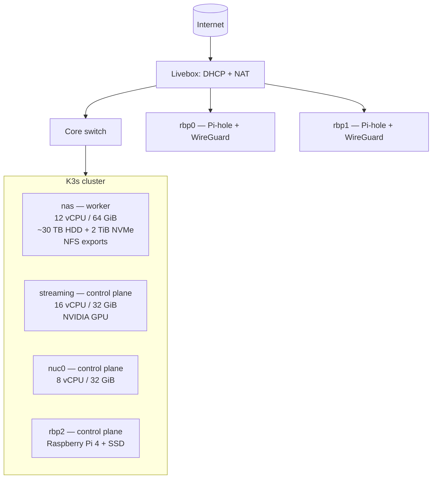

# Homelab

A Kubernetes-first homelab: six hand-built machines, one K3s cluster, GitOps through ArgoCD, and
Ansible for host preparation. It runs day-to-day services and doubles as a platform-engineering
portfolio.

> **The rebuild is over.** The storage layer lost to a disk failure in 2026 has been rebuilt on
> `local-path` and the NFS classes, and every workload is running. What changed, and why it deviates
> from what this file used to claim, is recorded in [`docs/`](docs/README.md).

## Current state

| Thing | Reality on the cluster, 2026-11-26 |
|---|---|
| K3s | `v1.36.6+k3s1` on all four nodes, containerd `2.3.7-k3s1.36`, embedded etcd |
| Ingress | Traefik `3.8.0`, chart `43.0.0`, owned by this repository since 2026-11-21; it was the K3s addon until then |
| Storage | `local-path` for configuration, the NFS classes for media and data. **No replicated storage:** Longhorn was abandoned after the disk failure and its volumes are gone |
| Applications | 67 ArgoCD Applications; no pod is `Pending` |
| GitOps coverage | Auto-sync is enabled per Application from the ArgoCD UI; no manifest in git records it |
| Backups | Four restic repositories in one OVH bucket, six nightly jobs. Every run completes, and `backup-verify` proves each stream is still advancing |
| Observability | Prometheus, Grafana and Loki on `nas`, Fluent Bit on all four nodes; Grafana evaluates the alert rules, and a relay writes a card on the `alerts` board |

The pages under [`docs/`](docs/README.md) are the authority on every row;
[`docs/how-it-works/`](docs/how-it-works/README.md) is the place to start.

## Architecture





The two Pi-holes are the LAN's DNS; the router does DHCP and NAT. K3s uses embedded etcd, so
control-plane quorum is two of three — never restart or upgrade two servers at once.

## How a change reaches the cluster

Commit to `develop` → the ArgoCD root app (`cluster/argocd/argocd-root.yaml`) syncs
`cluster/argocd` recursively → each Application under `projects/**` syncs its own source.

- `cluster/argocd/projects/**` holds **Applications**, despite the folder name.
- Editing `cluster/helm/**` takes effect when the commit reaches `develop`.
- Never `kubectl edit` or `kubectl apply` a resource ArgoCD manages; drift is fixed in git.
- `cluster/infrastructure/**` is **not** referenced by any Application and is applied by hand.
- Auto-sync is switched on from the ArgoCD UI rather than from git, because that is faster while
  debugging. It works, but the manifests in git understate the real policy — and a root-app sync that
  rewrites an Application can silently turn automation back off. Codify it per app when you touch it.

## Storage

| Class | Use |
|---|---|
| `local-path` (default) | application configuration, node-bound |
| `plex-media`, `nfs-audio`, `nfs-books`, `qbittorrent-download`, `nfs-syncthing`, `stash-nfs` | media and data on the NAS, one class per export |
| `traefik-nfs` | Traefik's ACME certificate store, on the NAS |

`local-path` volumes are tied to one node. Every workload is pinned to a named node and its
configuration volume lands on that same node; there is no failover, by design.

## Repository map

```
ansible/                  host playbooks (see the caveat in ansible/README.MD)
cluster/argocd/           root Application + per-app Applications (CRLF line endings)
cluster/helm/             57 charts: local charts and wrapper charts around upstream ones
cluster/infrastructure/   CoreDNS overrides, the system-upgrade controller, Traefik middlewares and TLS — applied by hand
kubectl/                  standalone manifests and one-shot helpers
docs/                     audit, design, plans, runbooks — the authoritative documents
```

## Documentation

Everything authoritative sits in `docs/`, and [`docs/README.md`](docs/README.md) indexes it. The
three files that used to describe this repo (`TODO.MD`, `REBUILD.md`, and an earlier version of this
README) were deleted on 2026-11-11 because they disagreed with each other and with the cluster.

## Validating before a commit

```bash
# every chart: helm lint and helm template, each dependency chart built in a temporary copy
hack/check-charts.sh

# documentation: generated pages, relative links, cited paths, nav and banners
hack/check-docs.sh

# check that ArgoCD references resolve (CRLF-safe)
while read -r p; do [ -d "$p" ] || echo "BROKEN PATH $p"; done < <(
  grep -rh '^    path:' cluster/argocd/projects | sed 's/^    path: *//' | tr -d "\"' \r")
```

A chart that pins an upstream dependency commits no `charts/` directory: `hack/check-charts.sh` runs
`helm dependency build` for it in a temporary copy and renders every chart with its own
`values.yaml`, so a fresh clone needs no manual build and no hand-kept list of exceptions.

## Conventions

Two-space YAML with lowercase keys. Files under `cluster/argocd/**` use CRLF. Ingress is Traefik
CRDs only, never `networking.k8s.io/v1`. Secrets are never committed. LinuxServer workloads keep
`TZ=Europe/Paris`, `PUID=1100`, `PGID=1100`.

`AGENTS.md` holds the operating notes for agents working in this repo, including the conventions in
more detail.
