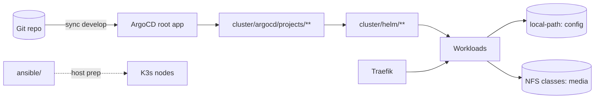
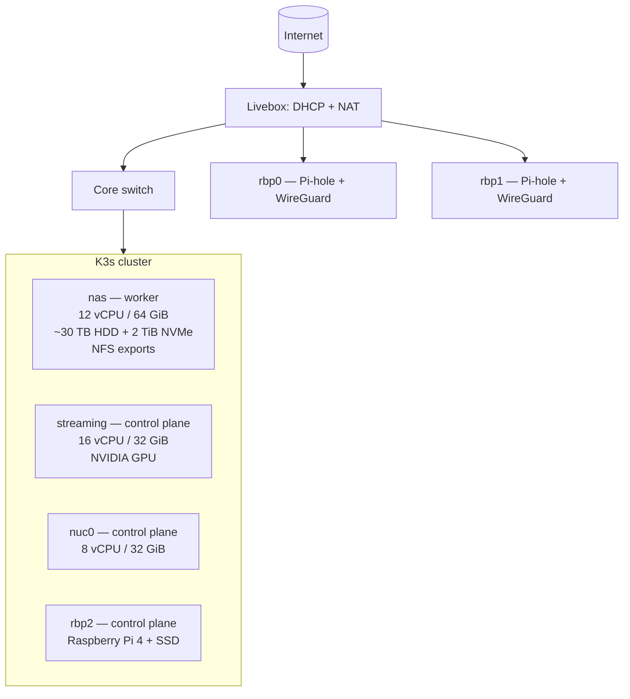

# Homelab

A Kubernetes-first homelab: six hand-built machines, one K3s cluster, GitOps through ArgoCD, and
Ansible for host preparation. It runs day-to-day services and doubles as a platform-engineering
portfolio.

> **This cluster is mid-rebuild.** The storage layer was lost to a disk failure in 2026 and is being
> rebuilt. Expect around 20 pods to be `Pending` and a handful of applications to be down. The plan
> that fixes it, and the reason for every deviation from what this file used to claim, live in
> [`docs/`](docs/README.md). Start with the programme index.

## Current state

| Thing | Reality on the cluster, 2026-11-12; counts include the observability branch |
|---|---|
| K3s | `v1.30.1+k3s1` on all four nodes, containerd, embedded etcd |
| Ingress | Traefik `2.9.4` from the K3s bundled addon (June 2023) |
| Storage | `local-path` for configuration, NFS provisioner classes for media. **No replicated storage.** |
| Replicated storage | Longhorn was abandoned after the disk failure. Its volumes are gone. |
| Applications | 58 ArgoCD Applications; about 20 are unhealthy |
| GitOps coverage | Auto-sync is enabled per Application from the ArgoCD UI; ~34 of the 58 manifests in git do not record it |
| Backups | **Not working.** The offsite target is an AWS S3 bucket and no script covers the control plane or PVC data |
| Observability | Prometheus with alerting disabled, Grafana down, no log pipeline |

The full evidence is in [`docs/audit/`](docs/audit/), captured 2026-11-10.

## Architecture





The two Pi-holes are the LAN's DNS; the router does DHCP and NAT. K3s uses embedded etcd, so
control-plane quorum is two of three — never restart or upgrade two servers at once.

## How a change reaches the cluster

Commit to `develop` → the ArgoCD root app (`cluster/argocd/argocd-root.yaml`) syncs
`cluster/argocd` recursively → each Application under `projects/**` syncs its own source.

- `cluster/argocd/projects/**` holds **Applications**, despite the folder name.
- Editing `cluster/helm/**` takes effect when the commit reaches `develop`.
- Never `kubectl edit` or `kubectl apply` a resource ArgoCD manages; drift is fixed in git.
- `cluster/infrastructure/**` is **not** referenced by any Application and is applied by hand.
- Auto-sync is switched on from the ArgoCD UI rather than from git, because that is faster while
  debugging. It works, but the manifests in git understate the real policy — and a root-app sync that
  rewrites an Application can silently turn automation back off. Codify it per app when you touch it.

## Storage

| Class | Use |
|---|---|
| `local-path` (default) | application configuration, node-bound |
| `nfs-plex`, `nfs-audio`, `nfs-books`, `nfs-stash`, `nfs-downloads`, `nfs-syncthing` | media and data on the NAS |

`local-path` volumes are tied to one node. Every workload is pinned to a named node and its
configuration volume lands on that same node; there is no failover, by design.

## Repository map

```
ansible/                  host playbooks (see the caveat in ansible/README.MD)
cluster/argocd/           root Application + per-app Applications (CRLF line endings)
cluster/helm/             49 charts: local, values-only, and a few still vendored
cluster/infrastructure/   Traefik config, storage classes — applied by hand
kubectl/                  standalone manifests and one-shot helpers
docs/                     audit, design, plans, runbooks — the authoritative documents
```

## Documentation

Everything authoritative sits in `docs/`, and [`docs/README.md`](docs/README.md) indexes it. The
three files that used to describe this repo (`TODO.MD`, `REBUILD.md`, and an earlier version of this
README) were deleted on 2026-11-11 because they disagreed with each other and with the cluster.

## Validating before a commit

```bash
# render every self-contained chart
for c in $(find cluster/helm -name Chart.yaml | xargs -n1 dirname); do
  helm template test "$c" --namespace test-ns >/dev/null || echo "FAIL $c"
done

# check that ArgoCD references resolve (CRLF-safe)
while read -r p; do [ -d "$p" ] || echo "BROKEN PATH $p"; done < <(
  grep -rh '^    path:' cluster/argocd/projects | sed 's/^    path: *//' | tr -d "\"' \r")
```

Charts that need `helm dependency build` first: `monitoring/prometheus`, `monitoring/grafana`,
`monitoring/loki`, `monitoring/fluent-bit`, `authentik`, `dashy`, `ashuvidz-website`,
`databases/pgadmin`, `discourse`, `postiz`.

## Conventions

Two-space YAML with lowercase keys. Files under `cluster/argocd/**` use CRLF. Ingress is Traefik
CRDs only, never `networking.k8s.io/v1`. Secrets are never committed. LinuxServer workloads keep
`TZ=Europe/Paris`, `PUID=1100`, `PGID=1100`.

`AGENTS.md` holds the operating notes for agents working in this repo, including the conventions in
more detail.
