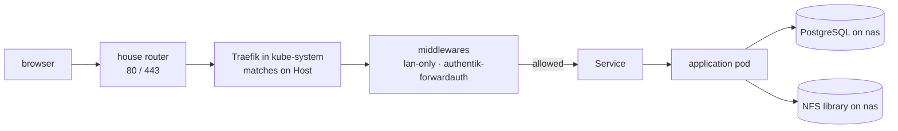
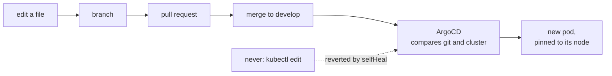

# The homelab in one page

> **In one line.** Four cluster nodes and two edge Pis, one door for traffic (Traefik), one door for
> change (a commit on `develop`), and five rules that explain most of what looks odd at first.
>
> **Use it when** you want the shape of the place before opening a topic page, or you are explaining it
> to someone · **Verified** 2026-11-17 · **Kind:** living page

## Four nodes, two edge Pis

`nas` holds the media library and the monitoring stack. `nuc0` runs the general catalogue, authentik
included. `streaming` has the GPU and runs Plex, the *arr apps (Sonarr, Radarr, Lidarr and Prowlarr, the
tools that fetch and organise media) and qBittorrent. `rbp2` runs nothing but the control plane. Two
Pis outside the cluster, `rbp0` and `rbp1`, answer DNS and the VPN. Which machine a pod belongs to, and
what a dead node takes with it: [Nodes](nodes.md).

## The path a request takes

You type a name in a browser. The house router forwards ports 80 and 443 to the cluster, and Traefik
answers on whichever cluster address the client reached. It routes on one thing, the `Host` header,
runs the middlewares the route names, and forwards to a single Service. The pod behind it reads its
database over the network, or its files from `nas` over NFS.

No route, no access: everything hangs off that arrow. [Network](network.md) owns the names, the
gate and the certificates; [Storage](storage.md) owns what the pod reads and what is lost when a
disk dies.

## The path a commit takes

The cluster is not edited by hand. You change a file on a branch, open a pull request, and merge it
into `develop`. ArgoCD compares `develop` with what is running and applies the difference: it renders
the chart and the pod is replaced, still on the machine its chart names.

A commit on a branch changes nothing, and a manual `kubectl edit` on a managed resource is undone at
the next comparison. [GitOps](gitops.md) carries the repository layout, the four ways a chart is
consumed, and the one application that does record automation.

## Five things to remember

1. **Every workload is pinned** to a named machine with
   `nodeSelector: kubernetes.io/hostname`. The DaemonSets are the deliberate exception: one pod per
   machine is their point.
2. **Configuration lives on `local-path`**: a directory on one machine's disk, created where the first
   pod lands. There is no replicated volume and no failover. Losing that disk loses the data.
3. **GitOps is the only door for applications.** A merge to `develop` is a deployment; a hand edit is
   drift that gets reverted. Secrets and `cluster/infrastructure/` are the documented exceptions.
4. **Every non-public route carries `lan-only`.** The router forwards 80 and 443 to the cluster and
   Traefik decides on `Host` alone, so a route without the gate answers the internet the moment its
   hostname exists.
5. **Native SSO first.** An app that speaks OIDC uses it. The forward-auth gate serves everyone who
   passed as the same anonymous person, so it is the fallback, not the default.

Rules 1 to 3, and what broke in 2026, are argued in
[The shape and why](the-shape-and-why.md); rule 4 is [Network](network.md), rule 5 is
[Identity](identity.md).

## Where to go next

| Page | Answers |
|---|---|
| [The shape and why](the-shape-and-why.md) | what failed, and the constraints that became rules |
| [Nodes](nodes.md) | which machines exist, placement, heat, what one loss costs |
| [GitOps](gitops.md) | how a commit becomes a pod, and what to edit for a change |
| [Storage](storage.md) | `local-path` against NFS, claim naming, Longhorn's corpse, backups |
| [Network](network.md) | DNS names, the LAN gate, TLS with the internal CA, public hostnames |
| [Identity](identity.md) | authentik, the groups, and the three ways a route can be protected |
| [Observability](observability.md) | what watches the cluster, what alerts, and what it misses |
| [Media](media.md) | the pipeline from indexer (a site that lists releases) to playback, and the books pair |
| [Applications](applications.md) | the catalogue: every application, its node, route and protection |

What is broken right now is [Application status](../status.md), and it is the only page that carries
counts.
