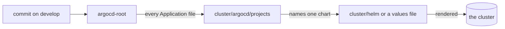

# How a change reaches the cluster

> **In one line.** A normal application change is a commit and a merge: ArgoCD applies what
> `develop` says. Three documented exceptions — hand-applied infrastructure, secrets and the
> auto-sync switch — leave that path.
>
> **Use it when** you are changing an application, adding one, or wondering why a sync did not happen
> · **Verified** 2026-11-17 · **Kind:** living page

## A commit's journey

A merge into `develop` is how a normal change reaches the cluster. ArgoCD compares each application
with git and applies the difference; a commit on a branch changes nothing.



The root Application
([`cluster/argocd/argocd-root.yaml`](../../cluster/argocd/argocd-root.yaml)) watches
`cluster/argocd` with `directory.recurse: true`, so it finds every Application file under
`projects/` without being told. It is the only Application that records automation, with `prune`
and `selfHeal` on. Each Application it finds pins `targetRevision:
develop` and points at one chart, or at a values file for a remote chart.

## The repository in one screen

| Path | What lives there |
|---|---|
| `cluster/argocd/` | The root Application and `projects/` — one YAML file per application. The folder holds Applications, not ArgoCD "projects", despite its name. |
| `cluster/helm/` | One chart per application, plus directories holding only a `values.yaml` for remote charts. |
| `cluster/infrastructure/` | Traefik configuration, middlewares, the TLS store and storage classes. **No Application owns this path**: it is applied by hand. |
| `kubectl/` | One-off manifests and the read-only RBAC for cluster access. |
| `ansible/` | Host preparation playbooks, outside GitOps. |
| `hack/` | The checkers — links, public exposure — the board tooling and one-off scripts such as `internal-cert.sh`. |

## Four ways a chart is consumed

- **A — local chart.** A chart under `cluster/helm/` that the Application names. Most applications.
  Example: `cluster/helm/media-stack/sonarr`.
- **B — remote chart plus a values file.** Two sources: the upstream chart repository, and this
  repository as a values ref. Legacy; four files still use it — `local-path`,
  `nfs/books-media`, `nfs/nfs-audio` and `renovate`. (`AGENTS.md` §3 still names six; that list lags.)
- **C — vendored upstream chart.** Committing the whole upstream chart and editing it in place. The
  last chart built this way, `postiz`, was retired on 2026-11-18 and nothing uses the pattern now;
  new external charts are D.
- **D — wrapper chart.** A small chart here pins the official chart as a dependency at an exact
  version and pins every image it renders. The way new external charts are consumed: `monitoring/`,
  `authentik`, `dashy`, `filebrowser`.

Some Application files under `projects/nfs/` point at a path that does not exist; `AGENTS.md` §7
keeps that list.

## Why auto-sync is not in git

Auto-sync is a switch per Application in the ArgoCD interface, and no Application file records it —
the root Application is the exception, because its job is to keep `cluster/argocd` itself in step.

A pull request that adds `syncPolicy.automated` is therefore a regression: the next root-app sync
rewrites the Application to match git and automation quietly turns off.

What to do when a sync stops:

1. Read the Application's status in the ArgoCD interface. `OutOfSync` with no sync means automation
   is off; re-enable it there.
2. `Sync failed` with a diff means the commit is wrong — fix it in git, do not patch the cluster.
3. `Unknown` or `Missing` usually means the chart or values path is wrong.

Never `kubectl edit` or `apply` a resource ArgoCD manages: `selfHeal` reverts it at the next
comparison.

## What to edit for a change

| I want to change | Edit | Then |
|---|---|---|
| an image tag | `image.tag` in that application's `values.yaml` | merge, sync, check the pod restarts |
| a setting, environment variable or resource | the same `values.yaml` | merge, sync |
| a hostname, route or access gate | the chart's IngressRoute and its middleware list | merge, sync, open the URL |
| a secret | nothing in git — create or update the Secret in the cluster | restart the pod; see [secrets.md](../secrets.md) |
| add an application | a chart under `cluster/helm/` and an Application file under `cluster/argocd/projects/` | the catalogue is [applications.md](applications.md) |
| a cluster-wide Traefik rule or storage class | `cluster/infrastructure/` | applied by hand, outside GitOps |

## Validate before merging

Run the checks for what you changed, from its chart directory:

```bash
helm lint . --namespace <ns>
helm template <release> . --namespace <ns> | kubeconform -strict -summary
```

Then `hack/check-exposure.sh`, which fails if a non-public route lost the LAN gate. The full chart checklist is in
[`charts/README.md`](../charts/README.md#checking-a-chart-against-this-list).

The branch, pull request, merge and board steps are in [`agent-protocol.md`](../agent-protocol.md).
