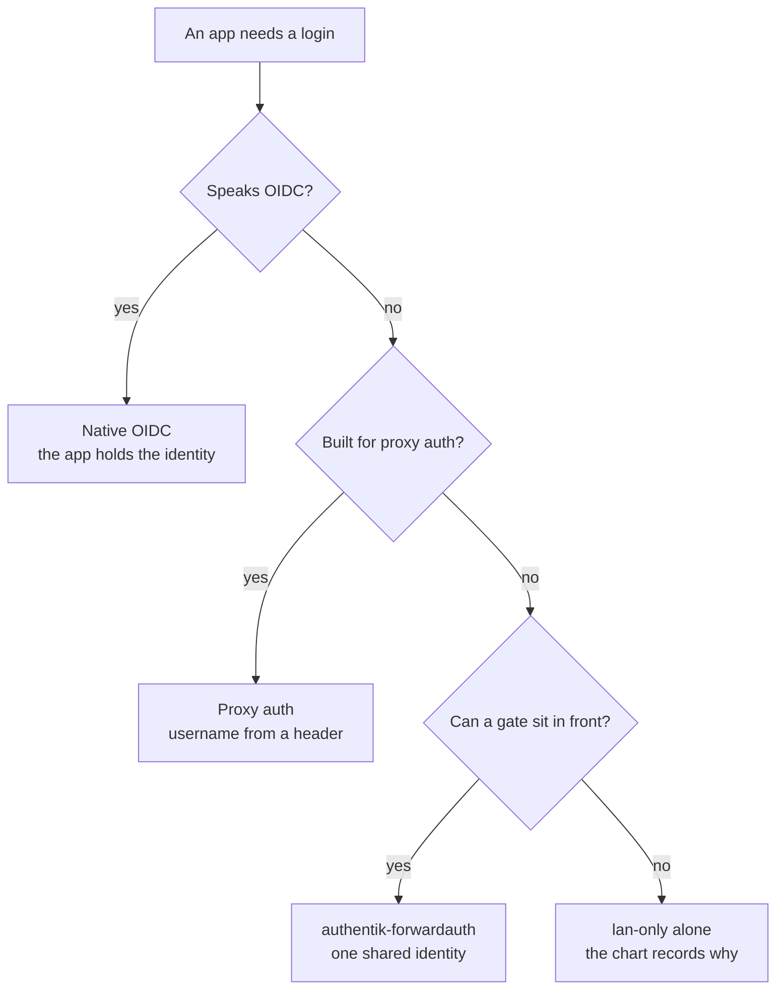

# Who gets in, and how an app is protected

> **In one line.** One authentik instance decides who a person is, and every app either speaks to it,
> takes proxy auth, sits behind a gate that asks it, or trusts the LAN alone — in that order.
>
> **Use it when** you are wiring an app to single sign-on, someone cannot get in, or you need to know
> what still works without authentik · **Verified** 2026-11-17 · **Kind:** living page

## authentik's job

authentik is the single identity provider: one account per person, and group membership deciding what
that account may open. It runs in the `authentik` namespace on `nuc0`, answering at
`https://authentik.kub.home.ashudev.com`.

Two *sources*, authentik's word for the places a person can prove who they are:

- **Discord**, for members of the homelab guild only. authentik asks Discord at each sign-in, so
  leaving the guild ends the access.
- **Plex**, for accounts that can already watch the library.

Both land on the same account: one identity, one set of groups. A Discord sign-in fails while Discord
is unreachable; a Plex sign-in does not.

## Three levels

| Level | Group | What it opens |
|---|---|---|
| Admin | `authentik Admins` | administers authentik, and the admin level inside apps that map groups |
| User | `homelab-users` | the user-safe applications, in their plain user role |
| Guest | `homelab-guests` | signs in and reaches nothing; where every new account lands |

Enrolment writes into `homelab-guests`; promoting somebody is adding them to `homelab-users` in the
UI. Group membership is not in git: it is an access decision, not configuration. Removing them takes
their applications away at their next sign-in without stopping them signing in.
`filebrowser-editors` is a *capability group*, adding one specific thing on top of a level; unused
until FileBrowser is wired. One admin group serves both because one person runs both, as reasoned in
the [SSO access-model design](../superpowers/specs/2026-11-14-sso-access-model-design.md#51-three-levels-and-the-admin-level-is-authentiks-own).

## Choosing how an app is protected

The order is fixed: **native OIDC first**, then proxy auth where the app is built for it, then the
`authentik-forwardauth` gate, then `lan-only` alone with the reason written next to the route.

- **OIDC** (OpenID Connect, the sign-in protocol where the app itself talks to authentik) wins because
  the app holds the identity: it shows the username, attributes a change to a person, and maps groups
  onto its own roles.
- **Proxy auth** is for an app built to take the username from a header rather than speak OIDC;
  FileBrowser is the case, deferred.
- **The gate** is `kube-system-authentik-forwardauth`, a Traefik middleware that asks authentik about
  every request. It is the fallback: everything behind it arrives as the same anonymous visitor.
- **`lan-only` alone** is last, and the chart must say why beside the middleware list.

`kube-system-authentik` is **headers, not a gate**; a route naming only it is protected by `lan-only`
and no user check. What each layer proves is in [network.md](network.md).

Every app sits at one of those four mechanisms, and
[reference/sso-applications.md](../reference/sso-applications.md) says which.

An API client sends a key, not a session, so it cannot complete a sign-in; a gated route may exempt
`/api` where the tool's own API checks that key. The pattern and its cost are in
[network.md](network.md).

## Break-glass

Every app that closed its own login keeps a way back — a git change or a documented command, never a
password here.

- **Argo CD** has `admin.enabled: "false"` and **Vikunja** sets `VIKUNJA_AUTH_LOCAL_ENABLED: "false"`;
  the way back is flipping that chart value and rolling the pod out, with the note beside the setting.
- **pgAdmin** returns to a local login by adding `internal` to its authentication config. **Kavita**
  keeps an API key; **Calibre-Web** keeps a local password that works on `http://localhost` only.
- **authentik itself** keeps the local `akadmin` account, deliberately without an MFA device, so a
  broken source cannot lock the operator out of fixing it.

## MFA

Optional. TOTP (a code from an authenticator app) and WebAuthn (a YubiKey) are enrolled from **MFA
Devices** in the person's settings, and the check applies to the source flows too, so Discord and Plex
sign-ins are covered. Two YubiKeys are two devices on one account and either satisfies the prompt;
recovery is deleting the lost device and enrolling again.

## Where the per-app detail is

The per-app matrix, the traps and the steps that wire a new application — blueprint, outpost list
(the proxy that serves the login pages), chart values — are
[reference/sso-applications.md](../reference/sso-applications.md). The walks for the applications
that speak OIDC themselves (the four client secrets, Grafana, pgAdmin, Kavita, Argo CD) are
[runbooks/authentik-apps.md](../runbooks/authentik-apps.md).
