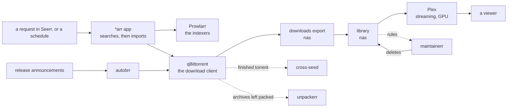

# The media pipeline, and what each app does

> **In one line.** A request or a schedule asks a *arr app for a release, the *arr app finds one through
> Prowlarr and hands it to qBittorrent, and Plex plays the finished file from the library on `nas`;
> the rest of the namespace are helpers around that loop.
>
> **Use it when** a download has not turned into a library item, you are adding a media app, or you want
> to know what one of the tools in `media-stack` is for · **Verified** 2026-11-17 · **Kind:** living page

## The pipeline, one diagram

The vocabulary, once. The ***arr apps*** are Sonarr, Radarr and Lidarr, with Prowlarr beside them: the
tools that decide what to fetch and where it goes. An *indexer* is a site that lists releases and their
download links. A *torrent* is a file fetched from many peers at once by a download client; usenet is
not used here. To *cross-seed* means to offer the same files on a second tracker.

Prowlarr holds the indexers, so each *arr app asks it rather than keeping its own list. The chosen
release becomes a torrent in qBittorrent, which writes into the downloads export on `nas`; the *arr app
moves the finished file into the library on the same NAS, and Plex reads it.

## Who does what

| App | Job | Where |
|---|---|---|
| Prowlarr | the one list of indexers | `streaming` |
| Sonarr, `sonarr-anime` | television: search, download, file | `streaming` |
| Radarr, `radarr-anime` | films | `streaming` |
| Lidarr | music | `streaming` |
| Bazarr, `bazarr-anime` | subtitles for the library | `streaming` |
| qBittorrent | the download client | `streaming` |
| cross-seed | seeds the same release on a second tracker | `streaming` |
| autobrr | grabs announced releases without a search | `streaming` |
| unpackerr | extracts packed archives | `streaming` |
| maintainerr | removes library items by rule | `streaming` |
| recyclarr | daily: quality profiles and custom formats | `nuc0` |
| Seerr | the request page for family and friends | `streaming` |
| Tautulli | Plex viewing statistics | `streaming` |
| Plex | playback; transcoding (converting video on the fly) on the GPU | `streaming` |

The two `-anime` twins give anime its own library roots, profiles and indexers, with separate
configuration.

**qBittorrent is not healthy.** Its Web UI and API stop answering during downloads, breaking cross-seed,
autobrr and the qBittorrent exporter while it lasts. It is an open fault with its own page:
[qbittorrent-webui-stalls.md](../qbittorrent-webui-stalls.md).

## The books pair

Two applications share one books library, and only one writes. **Calibre-Web Automated** (CWA) ingests,
converts and repairs books and holds their metadata and database; **Kavita** serves the same files,
mounting the claim read-only. That is the single-writer rule: CWA alone writes the library and its `metadata.db`.
CWA's drop folder is a small `local-path` claim beside the library, since CWA forbids a bind inside
another bind. Reasoning: [the books design](../superpowers/specs/2026-11-13-books-library-design.md);
cutover: [completed record](../runbooks/books-cutover.md).

## Where the files live

Media is on the NFS classes from `nas`: `nfs-plex` for film and television, `nfs-audio` for music,
`nfs-books` for the books library, `qbittorrent-download` for what is still downloading. Configuration
sits on `local-path` on the node each app runs on. The classes, the binding trap and the absence of
backups are [storage.md](storage.md); which claim belongs to which app is
[applications.md](applications.md).

Exception: qBittorrent's `/config` is on NFS, against that rule, and is the leading explanation for the
stall above.

## What protects each one

Every route but the two public ones below carries `lan-only`, then one of three things:

- **OIDC in the application** — autobrr, Calibre-Web Automated, Kavita, and since 2026-11-18 Radarr and
  Radarr Anime (Radarr 7). The app holds the identity; a gate on top would mean two logins.
- **The forward-auth gate** — Sonarr, Sonarr Anime, Lidarr, Prowlarr, both Bazzars,
  Maintainerr. The app behind it cannot tell its users apart; `maintainerr` checks no key of its own,
  so its `/api` exemption leaves `lan-only` as the only control.
- **LAN only, with the app's own login** — qBittorrent, and Tautulli since 2026-11-18. Tautulli
  cannot sit behind the gate either: the gate would make every browser the same user, and its whole
  point is per-user history.

**Plex** and **Seerr** are the two public ones: no `lan-only`, no gate, and Plex login is the gate,
because Plex clients and API callers cannot complete a browser sign-in. Seerr's local sign-in is off,
so its Plex users are the only way in.

What the four mechanisms mean, and why OIDC comes first: [network.md](network.md). The per-app matrix
and the media-tools traps: [reference/sso-applications.md](../reference/sso-applications.md).
