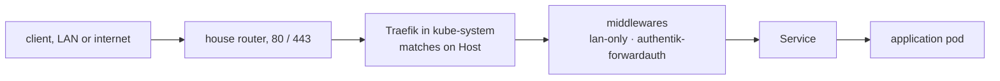

# How traffic reaches an application

> **In one line.** Every web request lands at Traefik on the cluster address the house router forwards
> to, and the route then decides whether it may come in, who has to sign in, and which certificate
> answers.
>
> **Use it when** you are adding a route, an app answers `403` or serves the wrong certificate, or you
> need to know whether a hostname is reachable from outside · **Verified** 2026-11-26 ·
> **Kind:** explanation
>
> **Sources** `cluster/helm/**/templates/*.yaml`, `cluster/argocd/projects/**/*.yaml`,
> `cluster/infrastructure/traefik/`, `cluster/helm/platform/network-policy/`, `hack/check_exposure.py`,
> and the router's own rules in [the Livebox record](../audit/livebox-2026-11-26.md)

## How a request arrives

Traefik is the only door for HTTP and HTTPS. It runs as a Kubernetes `LoadBalancer` Service in
`kube-system`, with no cloud load balancer behind the name: the house router forwards 80 and 443
(TCP), 25565 (TCP), 22000 (TCP and UDP) and 21027 (UDP) to **one** cluster address, `192.168.1.46`
(`streaming`), which is also what the edge Pi-hole answers for `*.kub.local`. The 25565 and
22000/21027 entries are Minecraft and Syncthing, which Traefik owns as entry points; the router also
forwards 25565 on UDP, where the `Service` publishes nothing.

The router's only other rules are three WireGuard forwards to the two edge Pis: 51820 (TCP and UDP)
on `rbp1`, and 51821 and 51822 (UDP) on `rbp0` and `rbp1`. Nothing else is forwarded — the four Plex
and DLNA rules the box still carried on 2026-11-26 are deleted. [The Livebox
record](../audit/livebox-2026-11-26.md) is the measured table and the removal.

One pod serves all of that, not one per node. K3s's service load balancer still puts a small proxy pod
on every node, so the other three node addresses answer as well — those packets then cross the LAN to
`streaming`. A second Traefik would change nothing for traffic from outside: one forwarded address is
one entry node. It would also be the failure this page's sibling runbook exists to prevent, since two
routers share one certificate file with no lock
([traefik-release.md](../runbooks/traefik-release.md)).

It routes on one thing: the `Host` header. A route is an `IngressRoute`: a hostname, the
middlewares to run before the request is forwarded, and the Service behind it. Middlewares are where
every gate and redirect lives, which is why a chart's `values.yaml` says more about protection than its
templates do.

## Names

`*.kub.local` is the internal space. The edge Pi-hole answers that whole wildcard with one address,
`192.168.1.46`, and public DNS has no entry, so they never resolve for an off-LAN client.

The public set is the allowlist in `hack/check_exposure.py`, listed host by host in
[`reference/routes.md`](../reference/routes.md): `plex.kub.home.ashudev.com`,
`seerr.kub.home.ashudev.com`, `ashuvidz.com`, `ashudev.com` with its `www`,
`dashy.ashudev.com`, `filebrowser.kub.home.ashudev.com` and `authentik.kub.home.ashudev.com`.
Nothing else answers the internet ungated.

The awkward middle is the rest of `*.kub.home.ashudev.com`: a real domain, publicly resolvable, which
the Pi-hole overrides to `192.168.1.46` *on the LAN only*. A name under that suffix therefore answers
the internet the moment its route exists, so DNS cannot be the fence, hence the next section.
`kavita.kub.home.ashudev.com` sits right there.

## Three layers that look alike

All three sit on the route and can answer `403`, hence the confusion.

| On the route | What it proves | What it costs |
|---|---|---|
| `lan-only` | the request came from a network we own | nothing; it knows no user |
| `authentik-forwardauth` | a valid authentik session exists | the app never learns who you are |
| OIDC on the app itself | the app holds the identity and shows the username | the app has to support it |

`lan-only` allows `192.168.1.0/24` (the LAN), `10.8.0.0/24` (WireGuard) and `10.42.0.0/16` (pods, so a
server-side OIDC call to a public hostname is not refused by our own wall). Anything else gets `403`
before authentik is asked.

A *forward-auth gate* is a middleware that asks authentik about each request before letting it through;
the app behind it serves everyone who passed, as the same anonymous person. `authentik` on its own is
headers, not authentication — a route named with it is gated by nothing.

The order of preference is native OIDC first, then proxy auth where the app is built for it, then the
gate, then `lan-only` alone with the reason written next to it. Per-app detail is in
[reference/sso-applications.md](../reference/sso-applications.md); what the mechanisms are is
[identity.md](identity.md).

## Pod to pod, inside the cluster

Nothing above applies between two pods: Traefik is not involved, no middleware runs, and any Service is
reachable by name from any namespace. The fence there is a `NetworkPolicy`, and it is the one this
cluster is short of — a compromised Plex or Seerr reaches PostgreSQL, authentik, the CrowdSec LAPI and
Prometheus, and only each service's own login stands in the way.

`cluster/helm/platform/network-policy` holds the fence: a `default-deny-ingress` that selects every pod
of a namespace, and one `allow-<consumer>` per caller that opens exactly the port it uses. It is applied
once per namespace by its own Application, so a rollout and a rollback are one namespace wide —
`vikunja`, `filebrowser`, `databases` and `media-stack` today. The first three were read from their
charts; `media-stack` was measured from the running applications on 2026-11-26, because its
twenty-one pods call each other on addresses stored in the applications' own databases rather than in
git, and `values/media-stack.yaml` names the source of each pair.

**Egress is not covered.** The chart denies inbound connections only, so a pod in one of those
namespaces still opens whatever it likes on its own. And whether this K3s enforces a `NetworkPolicy`
peer at all is not settled: the chart's README records the two measurements that disagree and the three
commands that decide it.

## TLS on `kub.local`

Internal routes set neither `secretName` nor `certResolver`. They fall through to
`kube-system/local-cert`, the default certificate: `*.kub.local`, signed by the ashulab internal CA,
selected through the `internal-tls` TLSOption that `traefik-gate` applies. A `web` twin router with the
same host only redirects to it, and carries `lan-only` and nothing else — putting the gate on the
redirect would send a plain-HTTP visitor through authentik and back to plain HTTP.

Clients install the CA root once. Without it a browser warns and can be clicked past; with it the lock
is real. The root, its two backups and the restore drill are
[runbooks/internal-ca.md](../runbooks/internal-ca.md).

## TLS on the public names

Two Let's Encrypt certificates cover every public name.

- One `ashudev.com` certificate carries `ashudev.com`, `*.ashudev.com`, `*.kub.home.ashudev.com` and
  the bare `kub.home.ashudev.com` — a wildcard stands for one label, so it does not cover that one. A wildcard can only be validated by a DNS record (the "DNS-01 challenge",
  proving the domain by writing a value into its zone), so this one goes through the OVH API.
- One `ashuvidz.com` certificate carries the apex and `www`. Its zone has answered from OVH
  nameservers since 2026-11-22, so it is validated through the same API, under the same resolver and
  the same credential as the wildcard; the older TLS challenge on port 443 is no longer used at all.

Only the apex route of each domain asks for a certificate (`tls.certResolver` with `tls.domains`);
every other route is served from the certificate store by SNI. Adding an application under
`ashudev.com` therefore orders nothing. The store, its single resolver and the pruning procedure are
[runbooks/acme-store.md](../runbooks/acme-store.md), and the design is
[the wildcard spec](../superpowers/specs/2026-11-22-traefik-acme-wildcard-design.md).

## API exemptions

An API client sends a key, not a browser session, so it cannot complete a sign-in. A gated chart can
therefore carry `apiBypassMiddlewares: [lan-only]`, which renders a second rule on
`Host(...) && PathPrefix(/api)` at `priority: 100` with the gate removed. Only do this where the API
checks a key itself. `maintainerr` checks none, so its exemption leaves `lan-only` as the only control;
a `basicauth` on that path is how to close it.

## Public exposure

`hack/check_exposure.py` encodes the allowlist above and runs over `helm template` output before a PR.
It fails both ways: a non-public host missing `kube-system-lan-only@kubernetescrd`, and a public host
that carries the gate, since that would make it unreachable. `kavita` has a `certResolver` and a public
name but is not on the allowlist, so its gate is required, not optional.

The full hostname table — app, gate, certificate, public or not — is
[reference/routes.md](../reference/routes.md), the one home for route and gate state. It is rendered
from the Applications' charts. The Traefik dashboard is one of those routes now: its `websecure`
router is rendered from the `traefik` chart's values, and only its `web` twin is outside the table,
applied by hand from `cluster/infrastructure/traefik/dashboard/redirect.yaml`.

The guarantees this arrangement makes, what enforces each one and the command that proves it are
[the security section](../security/README.md).
