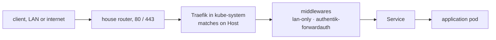

# How traffic reaches an application

> **In one line.** Every request lands at Traefik on one of the cluster's own addresses, and the route
> then decides whether it may come in, who has to sign in, and which certificate answers.
>
> **Use it when** you are adding a route, an app answers `403` or serves the wrong certificate, or you
> need to know whether a hostname is reachable from outside · **Verified** 2026-11-17 · **Kind:** living
> page

## How a request arrives

Traefik is the only door. It runs as a Kubernetes `LoadBalancer` Service in `kube-system`, with no
cloud load balancer behind the name: the house router forwards ports 80 and 443 to every cluster
address (`192.168.1.27`, `.41`, `.46`, `.48`), so Traefik answers on whichever one the client reached.

It routes on one thing: the `Host` header. A route is an `IngressRoute`: a hostname, the
middlewares to run before the request is forwarded, and the Service behind it. Middlewares are where
every gate and redirect lives, which is why a chart's `values.yaml` says more about protection than its
templates do.

## Names

`*.kub.local` is the internal space. The edge Pi-hole answers that whole wildcard with one address,
`192.168.1.46`, and public DNS has no entry, so they never resolve for an off-LAN client.

Five hostnames are public, and only these: `plex.kub.home.ashudev.com`, `seerr.kub.home.ashudev.com`,
`ashuvidz.com`, `forum.ashuvidz.com`, `wiki.ashuvidz.com`.

The awkward middle is the rest of `*.kub.home.ashudev.com`: a real domain, publicly resolvable, which
the Pi-hole overrides to `192.168.1.46` *on the LAN only*. A name under that suffix therefore answers
the internet the moment its route exists, so DNS cannot be the fence, hence the next section.
`kavita.kub.home.ashudev.com` sits right there.

## Three layers that look alike

All three sit on the route and can answer `403`, hence the confusion.

| On the route | What it proves | What it costs |
|---|---|---|
| `lan-only` | the request came from a network we own | nothing; it knows no user |
| `authentik-forwardauth` | a valid authentik session exists | the app never learns who you are |
| OIDC on the app itself | the app holds the identity and shows the username | the app has to support it |

`lan-only` allows `192.168.1.0/24` (the LAN), `10.8.0.0/24` (WireGuard) and `10.42.0.0/16` (pods, so a
server-side OIDC call to a public hostname is not refused by our own wall). Anything else gets `403`
before authentik is asked.

A *forward-auth gate* is a middleware that asks authentik about each request before letting it through;
the app behind it serves everyone who passed, as the same anonymous person. `authentik` on its own is
headers, not authentication — a route named with it is gated by nothing.

The order of preference is native OIDC first, then proxy auth where the app is built for it, then the
gate, then `lan-only` alone with the reason written next to it. Per-app detail is in
[reference/sso-applications.md](../reference/sso-applications.md); what the mechanisms are is
[identity.md](identity.md).

## TLS on `kub.local`

Internal routes set neither `secretName` nor `certResolver`. They fall through to
`kube-system/local-cert`, the default certificate: `*.kub.local`, signed by the ashulab internal CA,
selected through the `internal-tls` TLSOption that `traefik-gate` applies. A `web` twin router with the
same host only redirects to it, and carries `lan-only` and nothing else — putting the gate on the
redirect would send a plain-HTTP visitor through authentik and back to plain HTTP.

Clients install the CA root once. Without it a browser warns and can be clicked past; with it the lock
is real. The root, its two backups and the restore drill are
[runbooks/internal-ca.md](../runbooks/internal-ca.md).

## API exemptions

An API client sends a key, not a browser session, so it cannot complete a sign-in. A gated chart can
therefore carry `apiBypassMiddlewares: [lan-only]`, which renders a second rule on
`Host(...) && PathPrefix(/api)` at `priority: 100` with the gate removed. Only do this where the API
checks a key itself. `maintainerr` checks none, so its exemption leaves `lan-only` as the only control;
a `basicauth` on that path is how to close it.

## Public exposure

`hack/check_exposure.py` encodes the allowlist above and runs over `helm template` output before a PR.
It fails both ways: a non-public host missing `kube-system-lan-only@kubernetescrd`, and a public host
that carries the gate, since that would make it unreachable. `kavita` has a `certResolver` and a public
name but is not on the allowlist, so its gate is required, not optional.

The full hostname table — app, gate, certificate, public or not — is
[reference/routes.md](../reference/routes.md), the one home for route and gate state.
[status.md](../status.md) carries the applications that are not working.
