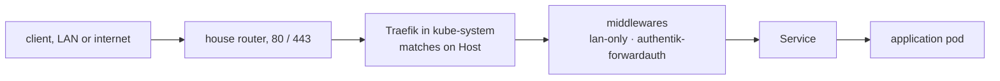

# How traffic reaches an application

> **In one line.** Every web request lands at Traefik on the cluster address the house router forwards
> to, and the route then decides whether it may come in, who has to sign in, and which certificate
> answers.
>
> **Use it when** you are adding a route, an app answers `403` or serves the wrong certificate, or you
> need to know whether a hostname is reachable from outside · **Verified** 2026-11-27 ·
> **Kind:** explanation
>
> **Sources** `cluster/helm/**/templates/*.yaml`, `cluster/argocd/projects/**/*.yaml`,
> `cluster/infrastructure/traefik/`, `cluster/infrastructure/coredns/`,
> `cluster/helm/platform/network-policy/`, `ansible/roles/resolver/`, `hack/check_exposure.py`,
> [the DNS4EU record](../decisions/2026-11-27-public-dns-is-dns4eu-unfiltered.md), and the router's own
> rules in [the Livebox record](../audit/livebox-2026-11-26.md)

## How a request arrives

Traefik is the only door for HTTP and HTTPS on the cluster's names — the two edge Pis are the one
exception, and it is written down [below](#the-edge-pis-are-the-one-exception). It runs as a
Kubernetes `LoadBalancer` Service in
`kube-system`, with no cloud load balancer behind the name: the house router forwards 80 and 443
(TCP), 25565 (TCP), 22000 (TCP and UDP) and 21027 (UDP) to **one** cluster address, `192.168.1.46`
(`streaming`), which is also what the edge Pi-hole answers for `*.kub.internal`. The 25565 and
22000/21027 entries are Minecraft and Syncthing, which Traefik owns as entry points; the 25565 rule
was narrowed to TCP on 2026-11-26, because the `Service` publishes nothing on UDP.

The router's only other rule is one WireGuard forward: `51821/udp` to `192.168.1.9`, the address
keepalived moves between the two Pis, so a client's config keeps working when the first host dies.
The second rule, `51822`, is deleted with the change that made the pair answer as one, and so is the
dead `51820` rule to `rbp1`. Nothing else is forwarded: the four Plex and DLNA rules the box still
carried are deleted. [The Livebox record](../audit/livebox-2026-11-26.md) is the measured table and
the removals; [`docs/runbooks/edge-vpn-failover.md`](../runbooks/edge-vpn-failover.md) is the pair.

The two hosts agree on who holds that address by VRRP, which is IP protocol 112 and carries no port,
so the firewall rule that lets it through names `proto vrrp` and a source of the other Pi alone.
`ufw allow … port 112 proto udp` matches nothing, and the default deny would leave both hosts
claiming the address.

One pod serves all of that, not one per node. K3s's service load balancer still puts a small proxy pod
on every node, so the other three node addresses answer as well — those packets then cross the LAN to
`streaming`. A second Traefik would change nothing for traffic from outside: one forwarded address is
one entry node. It would also be the failure this page's sibling runbook exists to prevent, since two
routers share one certificate file with no lock
([traefik-release.md](../runbooks/traefik-release.md)).

It routes on one thing: the `Host` header. A route is an `IngressRoute`: a hostname, the
middlewares to run before the request is forwarded, and the Service behind it. Middlewares are where
every gate and redirect lives, which is why a chart's `values.yaml` says more about protection than its
templates do.

## Names

`*.kub.internal` is the internal space. The edge Pi-hole answers that whole wildcard with one address,
`192.168.1.46`, and public DNS has no entry, so those names never resolve for an off-LAN client. The
old zone, `*.kub.local`, still resolves to the same address and is answered by one wildcard redirect
in `traefik-gate` until the soak ends; why it moved has its own section below.

The public set is the allowlist in `hack/check_exposure.py`, listed host by host in
[`reference/routes.md`](../reference/routes.md): `plex.kub.home.ashudev.com`,
`seerr.kub.home.ashudev.com`, `ashuvidz.com`, `ashudev.com` with its `www`,
`dashy.ashudev.com`, `filebrowser.kub.home.ashudev.com` and `authentik.kub.home.ashudev.com`.
Nothing else answers the internet ungated.

The awkward middle is the rest of `*.kub.home.ashudev.com`: a real domain, publicly resolvable, which
the Pi-hole overrides to `192.168.1.46` *on the LAN only*. A name under that suffix therefore answers
the internet the moment its route exists, so DNS cannot be the fence, hence the next section.
`kavita.kub.home.ashudev.com` sits right there.

## Who answers for a name

Every client on the LAN asks `192.168.1.22` and then `192.168.1.38`, the two edge Pi-holes. Pi-hole
holds the local records and the blocklist, and it forwards everything it does not know to DNS4EU's
**unfiltered** pair, `86.54.11.100` and `86.54.11.200`. Nothing in the house asks Cloudflare, Google
or Quad9, and no filtered DNS4EU variant is used, because Pi-hole is the only filter in the path.
Two pods carry their own resolvers rather than resolving through the cluster: `qbittorrent`, whose
tracker lookups leave through an AirVPN tunnel and are answered by that tunnel's resolver, `10.4.0.1`,
and `blackbox-exporter`, whose probes must see the public zone rather than Pi-hole's LAN override and
so ask DNS4EU directly. A public resolver beside the Pi-hole on a node is a fault, not a fallback: on
2026-11-26 `nuc0`'s `/etc/resolv.conf` named `1.1.1.1`, and CoreDNS sent about one `*.kub.local` query
in three there instead of to the Pi-hole.

The addresses, the rejections and the cost of being wrong are in
[`decisions/2026-11-27-public-dns-is-dns4eu-unfiltered.md`](../decisions/2026-11-27-public-dns-is-dns4eu-unfiltered.md).

The node's resolver is owned by `ansible/roles/resolver`: netplan names the two Pis and refuses DHCP's
nameservers, systemd-resolved keeps its stub listener off, and `/etc/resolv.conf` is the list that
results. For the pods that inherit a node's file — CoreDNS among them —
`cluster/infrastructure/coredns/custom.yaml` forwards `*.kub.internal` and `*.kub.local` to the same
pair, so neither wildcard reaches a resolver that would answer NXDOMAIN.

## Why the internal zone is `kub.internal`

Android 12 and later resolve every name ending in `.local` through mDNS: the query goes to
`224.0.0.251:5353` and never to the DNS server of the Wi-Fi network. AOSP documents that VPN and
mobile-data connections are excluded from that treatment, which is why the same name worked over
WireGuard and timed out on the house Wi-Fi. RFC 6762 reserves `.local` for exactly that use.

`.internal` is reserved for private use by ICANN and is not delegated, so no public resolver answers
it and no client special-cases it. A device resolves it by asking its configured DNS server, which
must be a Pi-hole. The old zone still answers through one wildcard redirect in `traefik-gate` until
the soak ends.

## Three layers that look alike

All three sit on the route and can answer `403`, hence the confusion.

| On the route | What it proves | What it costs |
|---|---|---|
| `lan-only` | the request came from a network we own | nothing; it knows no user |
| `authentik-forwardauth` | a valid authentik session exists | the app never learns who you are |
| OIDC on the app itself | the app holds the identity and shows the username | the app has to support it |

`lan-only` allows `192.168.1.0/24` (the LAN), `10.8.0.0/24` (WireGuard) and `10.42.0.0/16` (pods, so a
server-side OIDC call to a public hostname is not refused by our own wall). Anything else gets `403`
before authentik is asked.

A *forward-auth gate* is a middleware that asks authentik about each request before letting it through;
the app behind it serves everyone who passed, as the same anonymous person. `authentik` on its own is
headers, not authentication — a route named with it is gated by nothing.

The order of preference is native OIDC first, then proxy auth where the app is built for it, then the
gate, then `lan-only` alone with the reason written next to it. Per-app detail is in
[reference/sso-applications.md](../reference/sso-applications.md); what the mechanisms are is
[identity.md](identity.md).

## Pod to pod, inside the cluster

Nothing above applies between two pods: Traefik is not involved, no middleware runs, and any Service is
reachable by name from any namespace unless a `NetworkPolicy` says otherwise. The fence exists in four
namespaces — `vikunja`, `filebrowser`, `databases` and `media-stack`, all since 2026-11-26 — and the rest
of the cluster is still flat: a pod anywhere else reaches authentik, the CrowdSec LAPI, Prometheus and
every other Service, and only each service's own login stands in the way.

`cluster/helm/platform/network-policy` holds the fence: a `default-deny-ingress` that selects every pod
of a namespace, and one `allow-<consumer>` per caller that opens exactly the port it uses. It is applied
once per namespace by its own Application, so a rollout and a rollback are one namespace wide —
`vikunja`, `filebrowser`, `databases` and `media-stack` today. The first three were read from their
charts; `media-stack` was measured from the running applications on 2026-11-26, because its
twenty-one pods call each other on addresses stored in the applications' own databases rather than in
git, and `values/media-stack.yaml` names the source of each pair.

**Egress is not covered.** The chart denies inbound connections only, so a pod in one of those
namespaces still opens whatever it likes on its own.

**The fence is real, and it was proven the hard way.** The four Applications were synced on
2026-11-26, `media-stack` last, and it is a `NetworkPolicy` engine that enforces, not a tally in git:
one caller nobody had listed — the `monitoring` alert relay, which opens a board card by calling
`vikunja:3456` directly rather than through Traefik — was refused with `Connection refused` the minute
the floor landed, and its allow was added. `media-stack` is where a missing pair would hide longest, so
every one of its 51 pairs was probed from the calling pod and the download path was tested through the
apps' own APIs afterwards; the chart's README holds the checks, the numbers and the story.

## TLS on `kub.internal`

Internal routes set neither `secretName` nor `certResolver`. They fall through to
`kube-system/local-cert`, the default certificate: `*.kub.internal`, with `*.kub.local` beside it in
the SAN until the soak ends, signed by the ashulab internal CA and selected through the `internal-tls`
TLSOption that `traefik-gate` applies. A `web` twin router with the
same host only redirects to it, and carries `lan-only` and nothing else — putting the gate on the
redirect would send a plain-HTTP visitor through authentik and back to plain HTTP.

Clients install the CA root once. Without it a browser warns and can be clicked past; with it the lock
is real. The root, its two backups and the restore drill are
[runbooks/internal-ca.md](../runbooks/internal-ca.md).

### The edge Pis are the one exception

The two Pi-holes serve their own admin surfaces from the host, not through this router. Both now
present per-host leaves from the same internal CA: Pi-hole's panel and API on 443 as
`pihole-rbp0.kub.local` and `pihole-rbp1.kub.local`, and the wg-easy VPN panel on 8443 behind a Caddy
container as `vpn-rbp0.kub.local` and `vpn-rbp1.kub.local`. All four names are mapped by Pi-hole's own
`02-my-wildcard-dns.conf` above its `kub.internal` and `kub.local` wildcards. The leaf is per host on purpose: the shared
`*.kub.internal` key on an edge host would be a key to every internal name.

Neither is a Traefik route, and that is the point: the VPN panel has to open when the cluster is down,
which is also why it signs in with its own account. Nothing on an edge host goes through authentik
since 2026-11-26 ([the record](../decisions/2026-11-26-edge-pis-local-auth-only.md)): the OIDC client
it once pointed at a provider that never existed. Both panels were plain HTTP on `0.0.0.0:5000`
until 2026-11-26.

`8443` is not among the ports the router forwards — only the list at the top of this page is — so the
panel is reachable from the LAN and not from outside, the same position Pi-hole's own `443` holds.

Both hosts run `ufw` with default deny incoming and allow routed. The edge rule set opens 22, 80, 443
and 53 to the LAN, 53 from the compose network `172.30.0.0/24`, 53, 80 and 443 to the WireGuard tunnel
`10.8.0.0/24`, and 9100 and 9323 to the four cluster nodes; `ansible/roles/firewall/vars/main.yml` is
the record and `ansible/pi/hosts-pi.sh` applies it. The tunnel's own rules match nothing while wg-easy
masquerades a peer's traffic to its container address, so the `172.30.0.0/24` pair is what lets a peer
resolve through Pi-hole; before 2026-11-27 no rule admitted that source and the query was dropped.
Pi-hole's `443` is a host-network port and needs its rule. The published container ports on this page —
the WireGuard listener, Caddy's `8443` and the SMART exporter's `9902` — are DNAT'd before `INPUT` and
are not filtered by `ufw` at all.

## TLS on the public names

Two Let's Encrypt certificates cover every public name.

- One `ashudev.com` certificate carries `ashudev.com`, `*.ashudev.com`, `*.kub.home.ashudev.com` and
  the bare `kub.home.ashudev.com` — a wildcard stands for one label, so it does not cover that one. A wildcard can only be validated by a DNS record (the "DNS-01 challenge",
  proving the domain by writing a value into its zone), so this one goes through the OVH API.
- One `ashuvidz.com` certificate carries the apex and `www`. Its zone has answered from OVH
  nameservers since 2026-11-22, so it is validated through the same API, under the same resolver and
  the same credential as the wildcard; the older TLS challenge on port 443 is no longer used at all.

Only the apex route of each domain asks for a certificate (`tls.certResolver` with `tls.domains`);
every other route is served from the certificate store by SNI. Adding an application under
`ashudev.com` therefore orders nothing. The store, its single resolver and the pruning procedure are
[runbooks/acme-store.md](../runbooks/acme-store.md), and the design is
[the wildcard spec](../superpowers/specs/2026-11-22-traefik-acme-wildcard-design.md).

## API exemptions

An API client sends a key, not a browser session, so it cannot complete a sign-in. A gated chart can
therefore carry `apiBypassMiddlewares: [lan-only]`, which renders a second rule on
`Host(...) && PathPrefix(/api)` at `priority: 100` with the gate removed. Only do this where the API
checks a key itself. `maintainerr` checks none, so its exemption leaves `lan-only` as the only control;
a `basicauth` on that path is how to close it.

## Public exposure

`hack/check_exposure.py` encodes the allowlist above and runs over `helm template` output before a PR.
It fails both ways: a non-public host missing `kube-system-lan-only@kubernetescrd`, and a public host
that carries the gate, since that would make it unreachable. `kavita` has a `certResolver` and a public
name but is not on the allowlist, so its gate is required, not optional.

The full hostname table — app, gate, certificate, public or not — is
[reference/routes.md](../reference/routes.md), the one home for route and gate state. It is rendered
from the Applications' charts. The Traefik dashboard is one of those routes now: its `websecure`
router is rendered from the `traefik` chart's values, and only its `web` twin is outside the table,
applied by hand from `cluster/infrastructure/traefik/dashboard/redirect.yaml`.

The guarantees this arrangement makes, what enforces each one and the command that proves it are
[the security section](../security/README.md).
