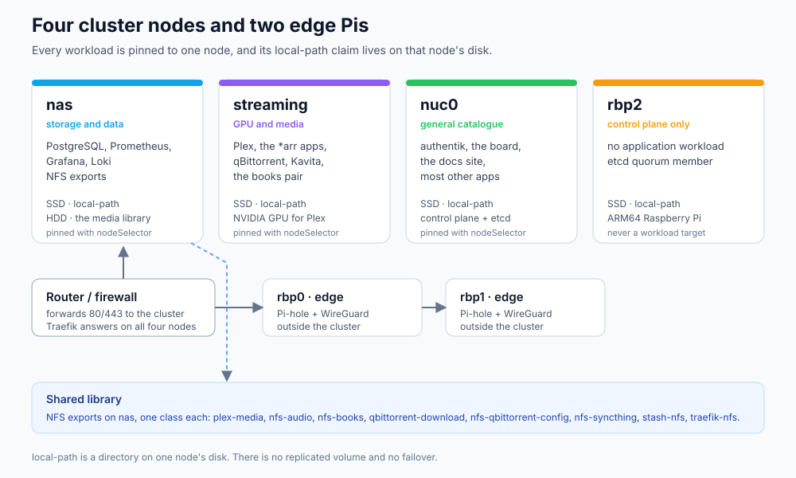

# The machines

> **In one line.** Four machines run the cluster and two smaller ones sit in front of it. Rebuilt
> workloads are pinned to a named machine and older charts are not, so this page is the map you read
> before moving anything.
>
> **Use it when** you are about to place an application, want to know what a machine is for, or need
> to know what a dead node would take with it · **Verified** 2026-11-17 · **Kind:** living page

## The machines

Two Raspberry Pis sit outside the cluster: the **edge Pis**, `rbp0` and `rbp1`. They are small
single-board computers that run Pi-hole, the DNS filter every device on the LAN queries, and
WireGuard, the VPN that gets you in from outside. No Kubernetes workload runs on them.

The four cluster nodes are all `Ready`, with no memory or disk pressure, on K3s v1.30.1 and Ubuntu
22.04.5 LTS. `streaming` is the only one on a 6.8 kernel; the other three are on 5.15. Memory below
is the total Kubernetes reports for the node.

| Node | Role | CPU / architecture | Memory | What runs there |
|---|---|---|---|---|
| `nas` | worker | 12 vCPU, amd64 | ~62.6 GiB | the media library and its NFS exports, the observability stack (Prometheus, Grafana, Loki), PostgreSQL |
| `nuc0` | control plane, etcd | 16 vCPU, amd64 | ~62.4 GiB | the general catalogue: authentik, FileBrowser, Vikunja, Koillection, n8n, and the forum and chat tools |
| `streaming` | control plane, etcd, NVIDIA GPU | 16 vCPU, amd64 | ~31.2 GiB | Plex and transcoding, the *arr apps (Sonarr, Radarr, Lidarr and Prowlarr, the tools that fetch and organise media), qBittorrent and its download helpers, Seerr, Tautulli, Kavita, Calibre-Web |
| `rbp2` | control plane, etcd | 4 cores, arm64 | ~7.6 GiB | nothing but the control plane |

Three of the four are control-plane machines and hold etcd, the database that keeps the
cluster's own state. One of them down leaves the cluster running; two down stops it. What is healthy is
another question: [`status.md`](../status.md) records it on its own snapshot date, and carries
the counts.

## Placement is a rule, not a hint

Every rebuilt workload declares `nodeSelector: kubernetes.io/hostname: <node>`, so its pod runs
where the chart says. The DaemonSets — the log shipper, the node and disk exporters, and
Traefik — deliberately carry no pin: one pod per machine is the point.

The reason for pinning is the volume. Configuration lives on a `local-path` claim, a directory on one
machine's own disk ([storage.md](storage.md) covers the storage classes), and the class waits for the
first consumer: the directory is created on whichever node the first pod lands on. So the first
schedule decides where the data lives — an unpinned claim can end up on `rbp2` — and a later pin
does not move the volume. When the pin disagrees, the pod stays `Pending` with a
volume node-affinity event. That event names the nodes the pod was rejected from, not the data's
home; the affinity is on the PV, under `spec.nodeAffinity` (`kubectl get pv <pv> -o yaml`).

Older charts are the exception: they still ask for the retired `node-type` label through
`nodeAffinity` rather than a hostname pin. That label still constrains scheduling: the chart makes it
a required term, not a hint, but the live object can lag the chart until ArgoCD reconciles it, so a
chart that asks for `general` and a pod that last ran elsewhere is not a contradiction.
[applications.md](applications.md) records which charts these are and the node each pod was
observed on.

## What "no failover" costs

There is no replicated volume: one copy of each configuration directory, on one disk. If a node loses
its disk, it loses the applications pinned to it and their configuration, and their pods wait for that
machine to come back. The media library survives the loss of
any other node, because it lives on `nas` over NFS; losing `nas` itself takes the library. The
mitigation for both is a backup, not a second copy, and today none has been restored:
[storage.md](storage.md) carries the honest state and the design that owns the fix.

## Heat

`streaming` runs at its thermal ceiling under real load, and `nuc0` throttles because its chassis is
too small for its CPU. Both are accepted, neither is being repaired now, and neither sends
a notification. The measurements and the silences are in the two records:
[`streaming` overheating
deferred](../decisions/2026-11-13-streaming-overheating-deferred.md) and [`nuc0` throttling
accepted](../decisions/2026-11-13-nuc0-throttling-accepted.md).

## Where to look next

- [storage.md](storage.md) — the two storage worlds, claim naming, and the backup gap.
- [applications.md](applications.md) — every application with its node, route, protection and chart.
- [observability.md](observability.md) — what watches these machines, and the known holes.
