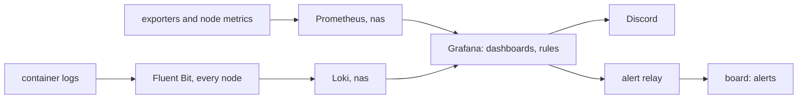

# What watches the cluster, and what it misses

> **In one line.** Prometheus keeps the numbers, Loki keeps the logs, Fluent Bit ships them, and Grafana
> draws both and decides to alert; the gaps matter as much as the components.
>
> **Use it when** you want to know whether a fault would be noticed, or where an alert came from ·
> **Verified** 2026-11-19 · **Kind:** living page

## What watches what

| Component | Job | Where | Keeps data for |
|---|---|---|---|
| Prometheus | collects metrics by scraping | `nas` | 90 days, 20 GiB cap |
| Loki | stores the logs | `nas` | 30 days |
| Fluent Bit | reads container logs on every node | DaemonSet, all nodes | nothing |
| Grafana | dashboards and alert rules | `nas` | its own database, not backed up |

All four are wrapper charts under `cluster/helm/monitoring/`; the design is
[`2026-11-12-observability-stack-design.md`](../superpowers/specs/2026-11-12-observability-stack-design.md).
The three stateful ones use `local-path` claims, so the cluster's memory sits on `nas`: losing that disk
loses the dashboards and the rules; losing the machine stops the watching.

## How metrics arrive

An exporter (a process publishing one service's numbers) is found by a `prometheus.io/scrape`
annotation on its pod, never a ServiceMonitor: there is no Prometheus Operator and its CRDs are not
installed. A new exporter needs the annotation, not a chart change; the interval is a minute.

The trap is size. K3s runs the control plane in one process, so each control-plane node republishes the
apiserver, etcd and scheduler *families* (one metric name and its label variants) three times over. Two
scrape jobs trim them back, `kubernetes-nodes` dropping the republished families and
`kubernetes-api-servers` the histogram buckets; without both trims Prometheus would need ~196k *series*
(one number over time per label set) and die at its 2 GiB limit.

Query recipes: [observability-conventions.md](../observability-conventions.md); exporter quirks and
measured series and targets: [reference/metrics.md](../reference/metrics.md#exporter-quirks).

## How logs arrive

Fluent Bit tails `/var/log/containers/*.log` on every node: container output only, no host logs, no
systemd journal. The line Loki stores is the application's own message: Fluent Bit strips its own
envelope (the pod labels, ids and CRI fields it used to attach) before the write, because those are
already stream labels or metadata. Labels are `job`, `namespace`, `container` and `node`; the pod
name is metadata, because it changes on every restart. What a line looks like now, and what it cost
before: [reference/metrics.md](../reference/metrics.md#exporter-quirks).

## What you look at

Dashboards live in Grafana's database, not in git, one question each:

| Dashboard | Question |
|---|---|
| Health | what is down, crashing or firing now? |
| Applications | why is this one namespace unhealthy? |
| Platform | nodes, control plane, Prometheus, when it is not an app |
| Logs | what is logged, and what is failing |
| Disks | drive health, life left, temperature, wear |
| Media | queues, downloads, Plex sessions |
| Showcase | a screen for a spare display |

Panels, query quirks, how to change one: [reference/dashboards.md](../reference/dashboards.md).

## Where alerts go

Grafana evaluates every rule itself, once a minute. Prometheus holds no rules and there is no
Alertmanager, so if Grafana cannot evaluate, nothing fires.

Discord is where a person notices: warnings repeat every 12 hours, criticals hourly. Criticals also
reach a relay that opens a card in the board's `alerts` project and comments as it repeats or resolves;
it never closes one; that is an investigation's job. Setup is
[runbooks/alert-relay.md](../runbooks/alert-relay.md), rules and silences are
[reference/alerts.md](../reference/alerts.md).

A silence suppresses the notification only: the rule still evaluates, reports firing and shows on
Health.

## What it misses

- **`local-path` claims publish no per-claim bytes**, so the claim-full rule is NFS-only; the filesystem
  rules watch that disk coarser.
- **No backup-freshness metric**: backups do not run, so an alert on them would lie.
- **No vulnerability scanning**: nothing reports which flaws the running images carry.
- **No blackbox probe, no certificate check outside Traefik**: a public name serving nothing goes
  unnoticed.
- **No GPU XID or ECC alert**; the NVIDIA exporter publishes temperature, utilisation and framebuffer
  only.
- **No metrics for the NFS provisioners or the Pi-hole resolver itself**, only its exporter.
- **Coverage outside pods and restarts is thin**: replica checks cover the core namespaces and
  `media-stack`; elsewhere only pod rules fire, and only recyclarr has a CronJob staleness check.
- **Alerting is one point**: if Grafana, Prometheus or `nas` goes down, no message is sent; accepted.
- **Two accepted faults are silenced, not fixed**: [`streaming`
  overheating](../decisions/2026-11-13-streaming-overheating-deferred.md) and [`nuc0`
  throttling](../decisions/2026-11-13-nuc0-throttling-accepted.md).

The full list, its evidence and re-check commands: [known gaps](../reference/alerts.md#known-gaps).
What is broken now: [status.md](../status.md).
