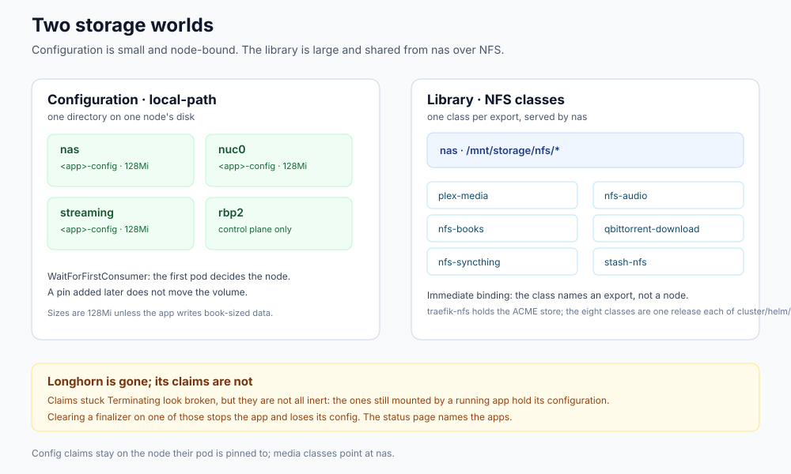

# Where the data lives

> **In one line.** Each application's configuration sits on one machine's own disk, the media library
> sits on `nas` over NFS, and neither has a second copy or a working backup.
>
> **Use it when** you are adding a claim, a pod will not start because of one, or you want to know what
> a backup would save · **Verified** 2026-11-20 · **Kind:** living page

## Two storage worlds

**Configuration** — what an app writes for itself: settings, a small database, its index — goes on
`local-path`, the default class: a directory on the disk of whichever machine the pod lands on, with
`strategy: Recreate` so only one pod opens it at a time.

**Shared media** goes on an NFS class: a directory that already exists on a `nas` export, mounted by
whichever pod reads it, so one library serves them all.

A `local-path` directory is a path on one node's filesystem, so a pod elsewhere cannot mount it —
hence the pinning rule in [nodes.md](nodes.md). NFS serves one copy to many readers; replicated
storage, the same volume on two machines, was Longhorn, gone for the reason in
[the-shape-and-why.md](the-shape-and-why.md).

## Claims and names

A configuration claim is `<app>-config`, `128Mi` unless there is a reason: configuration is small, and
GiB-sized guesses proved wrong. Two exceptions keep book-sized files in their own volume:
`calibre-web-automated` at `10Gi`, `kavita` at `2Gi`.



The [stabilisation design](../superpowers/specs/2026-11-10-homelab-stabilisation-design.md#82-storage-classes)
keeps a smaller named set and retires the rest; the NFS tail of that sweep landed on 2026-11-19, and
the classes below are what remains.

| Class | Binding | Used by |
|---|---|---|
| `local-path` (default) | WaitForFirstConsumer | every configuration claim, on that node's own disk |
| `plex-media` | Immediate | film and television |
| `nfs-audio` | Immediate | music |
| `nfs-books` | Immediate | the books library |
| `qbittorrent-download` | Immediate | qBittorrent's output |
| `nfs-qbittorrent-config` | Immediate | qBittorrent's state directory |
| `nfs-syncthing` | Immediate | Syncthing's folder |
| `stash-nfs` | Immediate | assets and documents: koillection's uploads are provisioned into this export, and FileBrowser reads the same directory |
| `traefik-nfs` | Immediate | Traefik's certificate store |

Every NFS class there is a directory on a `nas` export, declared by its own release of the wrapper
chart at `cluster/helm/nfs/provisioner/`: one chart, eight releases, one values file each. Two more
classes, `nfs-plex` and `nfs-ssd`, belonged to provisioners that existed only in the cluster — no
chart, no Application, no claim on either. They were uninstalled on 2026-11-19 with
`helm uninstall nfs-hdd nfs-ssd -n default`.

`local-path` is hostPath-backed: `fsGroup` does nothing, and `runAsUser` on a claim another UID wrote
makes `/config` unreadable. The safe order is in the chart contract —
[changing the UID breaks the config volume](../charts/README.md#changing-the-uid-breaks-the-config-volume).

## The binding trap

`local-path` binds on first consumer: the directory is created on the node where the first pod using
the claim lands. That schedule decides where the data lives; a pin added later does not move it.

The failure is a chart rebuild. `lidarr`, 2026-11-13: the claim bound to `nuc0` because the old pod's
affinity made it eligible, then the sync replaced the pod with one pinned to `streaming`. It stayed
`Pending` with `1 node(s) didn't find available persistent volumes to bind` — an event naming where the
pod may not run, not where the volume is.

Recovery while the claim holds nothing: delete the claim, let ArgoCD recreate it, then **delete the
pod**; otherwise the scheduler keeps queueing it against the old claim's identity. A `Retain` volume
stays as `Released` — delete it and its directory. The habit that avoids it: scale the old Deployment
to zero before the first sync that creates the claim.

## Four volumes stay marked for deletion

Longhorn is gone: the driver, its classes and custom resources, the namespace, all twenty-six volumes
and all six claims were cleared on 2026-11-18 and 2026-11-19. The record of how is
[the Longhorn page](../cleanup/longhorn-disposition.md).

Four volumes still show `Terminating` in `kubectl get pv`. They are not leftovers. They were asked to
delete on 2023-12-06, the deletion was blocked because each is bound to a live claim, and a deletion
timestamp cannot be cleared on a running object. They are **kept as they are, by decision on
2026-11-20**, and nothing is to be done about them:

| Volume | Claim | Mounted by | What it holds | Why it stays |
|---|---|---|---|---|
| `pv-traefik-nfs` | `kube-system/pvc-traefik-nfs` | the `traefik` DaemonSet | the ACME certificate store, `/mnt/storage/traefik` | every TLS route depends on it, and a bad replacement re-issues the certificates |
| `pv-plex-media` | `media-stack/pvc-plex-media` | `plex`, `sonarr`, `sonarr-anime`, `radarr`, `radarr-anime`, `bazarr`, `bazarr-anime` | film and television, `/mnt/storage/nfs/plexmedia` | seven workloads read it; replacing it buys nothing and stops all seven |
| `pv-stash-nfs-nfs-stash` | `media-stack/pvc-stash-nfs-nfs-stash` | the `stash-nfs` provisioner | assets and documents, `/mnt/storage/nfs/stash` | it is the export FileBrowser reads, and koillection's uploads are provisioned into it |
| `pv-nfs-qbittorrent-download-nfs-subdir-external-provisioner` | `media-stack/pvc-nfs-qbittorrent-download-nfs-subdir-external-provisioner` | `qbittorrent`, `unpackerr`, `sonarr`, `sonarr-anime`, `radarr`, `radarr-anime`, `lidarr` | the downloads queue, `/mnt/ultrafaststorage/nfs` | it is the in-flight queue every *arr application and the unpacker share |

Two facts keep them safe. Each volume is bound to a live claim, so its only finalizer is
`kubernetes.io/pv-protection`, the guard any in-use volume carries; and its reclaim policy is
`Retain`, so the directory on the NAS survives even a deletion that does complete. All four are
declared by the provisioner chart (`cluster/helm/nfs/provisioner/values/*.yaml`, with
`nfs.mountOptions` non-empty), so git still owns them and a sync recreates them.

**Their finalizers must never be patched.** They carry no `spec.csi`, which is exactly what the
Longhorn recipe filtered on, so a loop written for that cleanup cannot reach them; a hand-run patch
can. The check is:

```bash
kubectl get pv -o json \
  | jq -r '.items[] | select(.metadata.deletionTimestamp != null) | .metadata.name'
```

Expected: exactly those four names. A fifth volume in that list is a real leftover; the four above
are neither leftovers nor a problem.

Replacing one is possible and unnecessary. It means scaling to zero every workload mounting the claim
(the provisioner Deployment included, because it mounts the claim too), deleting the claim, letting
the pending volume deletion complete, syncing the Application so the chart recreates the pair, then
scaling back. The NFS directory is untouched throughout; a restart under load is the only cost.

## Backups

Plainly: no backup of this cluster works. The audit's
[backup table](../audit/observability-storage.md#3-backups) is the evidence: the K3s script dumps a
SQLite file this etcd cluster lacks; the NAS script writes to a MinIO path deleted in July 2024
([ansible audit](../audit/ansible-hosts.md)); host restic covers only the two edge Pis, to S3;
PostgreSQL's `pg_dumpall` writes into a dead Longhorn claim; Syncthing's restic job covers its
configuration alone.

The one thing with two copies is the internal CA's root key: a password-manager note and an offline
USB stick, both hand-made, while the automated offsite path is broken too
([runbooks/internal-ca.md](../runbooks/internal-ca.md)). W4, the offsite backup workstream, owns the
fix; until it lands, treat a lost disk as lost data. Which claim belongs to which app:
[applications.md](applications.md).
