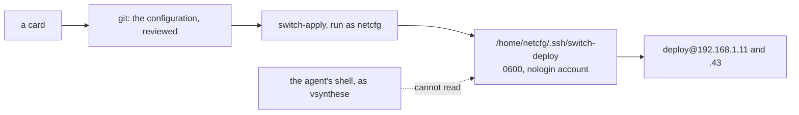

# An agent account on the switches, and the key it cannot read

> **In one line.** Each MikroTik switch carries a `deploy` account that may sign in, read and change
> configuration but cannot create a user or change a group, and whose private key sits under a UNIX
> user the agent's shell cannot read — so a prompt injected into an agent can run the apply script and
> cannot walk away with the key.
>
> **Use it when** you are creating that account, rotating its key, or checking what a switch accepts ·
> **Verified** 2026-11-25: the starting state, read from both switches over the API — `admin` and
> `monitoring` only, no SSH key on either, `/ip ssh` password login already off · **Kind:** how-to
>
> **Status:** pending one step. On 2026-11-25 both switches got the group, the user, the RSA import
> and the source-filter test; the key's own login is the one proof that needs the operator's
> terminal, because the key is unreadable from the agent's shell by design.
>
> **Sources** `ansible/collectors/network-audit.sh`,
> [`network state collector`](../superpowers/specs/2026-11-24-network-state-collector-design.md),
> [`declared host access`](../decisions/2026-11-25-declared-host-access.md)

## What the two accounts are for

One reads and one writes, and neither can do the other's job.

| Account | Group, and what it carries | Signs in with | May |
|---|---|---|---|
| `audit` | `audit` = `read,ssh`; no source-address limit | key only | print, export, monitor — nothing that writes |
| `deploy` | `deploy` = `read,write,ssh,test`; `address=192.168.1.0/24` | key only | change configuration, and nothing about users |
| `admin` | built-in `full` | password | everything; this page does not touch it |
| `monitoring` | built-in `read`, `address=0.0.0.0/0` | password, over the API | what mktxp collects — and it carries `sensitive` and `reboot`, which [the gap below](#the-gap-monitoring-sits-in-the-built-in-read-group) names |

A RouterOS *policy* is one permission badge: `read` is "run a print or an export", `write` is "change
the configuration", `ssh` is "open a session over SSH", and `policy` is "create an account or change
what a group may do".

**`deploy` holds no `policy`.** That is the whole fence: an account that passes the gate can change a
firewall rule, and cannot make itself an administrator. `admin` keeps the password login it already
has, so this account is never the only way in.

**The group is not the built-in `read`.** Measured on `192.168.1.11` on 2026-11-25, that group carries
`local,telnet,ssh,reboot,read,test,winbox,password,web,sniff,sensitive,api,romon,tikapp` — so `sensitive`,
which reads every secret the configuration holds, and `reboot`, which restarts the switch. `deploy`
holds neither, and `test` is there because the apply script pings the switch it just changed.

## Where the key lives

The chain is the point of the card: the agent may *run* a change, and may never *hold* the credential.



The custodian is the machine the agent's shell runs on, under a UNIX account of its own, `netcfg`,
whose shell is `/usr/sbin/nologin`. It exists to hold one file and to run one command through a
sudoers rule that card 698 adds.

**Why not a cluster node.** The agent holds `~/.ssh/homelab_live`, which is root on the four hosts, so
any key placed on a node is one `sudo cat` away from the agent. On the machine it runs on, `sudo`
asks for a password no prompt can type, and that is the only boundary in the estate that the agent's
own compromise does not cross.

## Before you start

- **An admin session on the switch** — `admin`, or any account in `full`. The commands below run in
  that session, not in the agent's shell.
- **The measured versions:** `192.168.1.11` runs RouterOS `6.49.8` (long-term) and `192.168.1.43`
  `6.49.7` (stable). Both are version 6, where the setting is `always-allow-password-login`; on 7.21
  and later it is `password-authentication`, and its default, `yes-if-no-key`, already refuses a
  password to any user holding a key. Card 696 is what moves them there, and it has to correct this
  page on the way.
- **The key's public half** on the switch, so the import can read it.

## 1. Make the key where the agent cannot read it

On the machine the agent's shell runs on:

```bash
sudo useradd --create-home --home-dir /home/netcfg --shell /usr/sbin/nologin netcfg
sudo chmod 700 /home/netcfg
sudo install -d -o netcfg -g netcfg -m 700 /home/netcfg/.ssh
sudo -u netcfg ssh-keygen -t rsa -b 4096 -N '' -C "switch-deploy" \
  -f /home/netcfg/.ssh/switch-deploy
```

**RSA, not ed25519, and the switch decides that.** RouterOS 6.49 rejects an ed25519 key with
`unable to load key file (wrong format?)` — measured on 2026-11-25 — because ed25519 import arrived
in 7.x. The card asks for ed25519; the device runs 6.49, so the pair is RSA 4096 until card 696 moves
them to version 7, and the swap is then a new pair and one import.

`useradd` leaves the home at `0750` on Ubuntu, where the group may traverse it; the `chmod` is what
makes the account's home unreadable to anything but `netcfg` itself.

Expected: two files. `ssh-keygen` prints the fingerprint, which is the one thing worth pasting into
the card. The private half is `0600`, owned by `netcfg`. Proved on 2026-11-25: `test -r` on the key
answers no from the agent's shell, and the `.ssh` directory cannot be listed.

## 2. Create the account, on each switch

Copy the public half to the switch — `scp switch-deploy.pub admin@192.168.1.11:` or FTP as `admin`,
both of which this switch accepts — then in the admin session:

```
/file print
/user group add name=deploy policy=read,write,ssh,test
/user add name=deploy group=deploy address=192.168.1.0/24 password="<random>" disabled=yes
/user ssh-keys import public-key-file=switch-deploy.pub user=deploy
/user enable deploy
/ip ssh set always-allow-password-login=no
/file remove switch-deploy.pub
```

Generate the password on the laptop with `openssl rand -hex 24` and paste it. It is never recorded,
and it cannot be typed anywhere useful: a user holding a key is refused a password login, so the
account has no password path at all. It exists so that an edit which turns password login back on
does not hand out a guessable account — an empty password is a blank login, a random one is not.

**Created disabled and enabled last**, so the account cannot authenticate by password in the window
between its creation and the import.

Expected, from `/user group print`: `deploy` reads exactly
`ssh,read,write,test,!local,!telnet,!ftp,!reboot,!policy,!winbox,!password,!web,!sniff,!sensitive,!api,!romon,!dude,!tikapp`.
Every policy the group does not name is revoked, which is why the list is worth reading rather than
trusting: no `policy`, no `password` of its own, and no `api` — SSH is the only door.

Expected, from `/user ssh-keys print`: one row, `user` `deploy`, its comment `switch-deploy` as the
owner, 4096 bits. Measured on both switches on 2026-11-25.

`/ip ssh` already reads `always-allow-password-login: no` on both switches, measured on 2026-11-25;
the command above declares that state instead of changing it.

`address=192.168.1.0/24` is a prefix the switch enforces: the account logs in from a matching source
address and from nowhere else. Narrowing it to the one address the custodian appears from is tighter
still, and breaks the day that address moves; the card chose the LAN.

Do it on the second switch too, with its own copy of the import.

## 3. Prove it

**The agent cannot read the key.** In the agent's shell:

```bash
cat /home/netcfg/.ssh/switch-deploy
test -r /home/netcfg/.ssh/switch-deploy && echo READABLE || echo "not readable"
```

Expected: `Permission denied`, then `not readable`. A `READABLE` here is the whole card failed, not a
detail: stop and fix the ownership.

**The key works, and the group is the fence.** As the operator — the only account that may use the
sudo rule, because only it can type the password sudo asks for:

```bash
sudo -H -u netcfg ssh -o BatchMode=yes -o StrictHostKeyChecking=accept-new \
  -i /home/netcfg/.ssh/switch-deploy deploy@192.168.1.11 '/system identity print'
sudo -H -u netcfg ssh -o BatchMode=yes -o StrictHostKeyChecking=accept-new \
  -i /home/netcfg/.ssh/switch-deploy deploy@192.168.1.11 '/user add name=probe group=full'
```

Expected: the identity prints, and the second answers `not enough permissions` and creates nothing.
`BatchMode=yes` is what keeps a refused key from turning into a password prompt, and `accept-new`
settles the switch's host key on the first contact, in `netcfg`'s `known_hosts` rather than the
operator's.

**A source outside the prefix is refused.** Moving the client is awkward — the key must not travel —
so the one variable that moves is the prefix itself, and the client stays put. A throwaway account
with a password does that in two steps, in the admin session:

```
/user add name=deploy-probe group=read address=10.99.0.0/24 password="<temporary, known>"
/user set deploy-probe address=192.168.1.0/24
```

Log in as `deploy-probe` with that password, once after each `set`. Measured on `192.168.1.11` on
2026-11-25: with `10.99.0.0/24` the login answers `not allowed to login from this address (9)`, and
with `192.168.1.0/24` it is accepted — same client, same credential, one field changed. That is the
field `deploy` carries, so it is the field that would refuse a caller from elsewhere. The credential
was used over the API, whose login passes through the same check as SSH.

Then remove it, in the same session:

```
/user remove deploy-probe
```

Proved the same day on `192.168.1.11`, and the account carries the same field on `192.168.1.43`.

## The gap: `monitoring` sits in the built-in `read` group

Measured on 2026-11-25, both switches carry `monitoring` with `group=read` and
`address=0.0.0.0/0`. It therefore holds `sensitive` and `reboot` from any address, and its password
lives in the `monitoring/mktxp-conf` Secret. That is the same defect this page exists to avoid for
`deploy`, on the account that predates it; it is filed as its own card rather than changed here,
because mktxp is a running service and the move needs its egress address pinned.

## Rotate a key, or retire the account

1. **Rotate:** replace `/home/netcfg/.ssh/switch-deploy`, then `/user ssh-keys remove [find user=deploy]`
   and import the new public half. The old key stops working when the import lands.
2. **Retire:** `/user remove deploy`, then `/user group remove deploy`, then delete the two files under
   `/home/netcfg/.ssh` and the `netcfg` account if nothing else uses it.
3. **A session already open stays open** until it ends. The device removes the credential; it does not
   close a connection that has already authenticated.

## What this page does not cover

- **The apply script and its revert timer** are card 698: this page creates the account it runs as, and
  nothing that applies a change.
- **The `audit` account and the collector.** Neither switch held an `audit` user on 2026-11-25, so
  `ansible/collectors/network-audit.sh` cannot run against a device yet. Creating it is the same
  procedure with `policy=read,ssh`, and its commands are in `ansible/README.MD`.
- **The `admin` password and the Livebox** are card 695.
