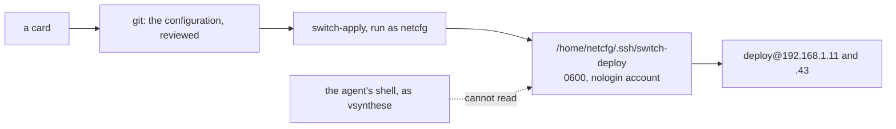

# An agent account on the switches, and the key it cannot read

> **In one line.** Each MikroTik switch carries a `deploy` account that may sign in, read and change
> configuration but cannot create a user or change a group, and whose private key sits under a UNIX
> user the agent's shell cannot read — so a prompt injected into an agent can run the apply script and
> cannot walk away with the key.
>
> **Use it when** you are creating that account, rotating its key, or checking what a switch accepts ·
> **Verified** 2026-11-25, run end to end on both switches: the group, the disabled-then-enabled user,
> the RSA 4096 import, the key's own login, `/user add` refused, and the source filter turning another
> prefix away; both switches moved to RouterOS `7.24.7` on 2026-11-26 with the same accounts and key ·
> **Kind:** how-to
>
> **Status:** proved 2026-11-25. One deviation from the card: the key is **RSA 4096**, not ed25519,
> because RouterOS 6.49 cannot import ed25519. v7 accepts that pair as it stands, and nothing needs
> the swap, so the pair is unchanged.
>
> **Sources** `ansible/collectors/network-audit.sh`, `ansible/switches/switch-apply.sh`,
> `ansible/switches/install-switch-change.sh`,
> [`network state collector`](../superpowers/specs/2026-11-24-network-state-collector-design.md),
> [`declared host access`](../decisions/2026-11-25-declared-host-access.md),
> [`the gate's design`](../superpowers/specs/2026-11-25-switch-change-gate-design.md)

## What the two accounts are for

One reads and one writes, and neither can do the other's job.

| Account | Group, and what it carries | Signs in with | May |
|---|---|---|---|
| `audit` | `audit` = `read,ssh`; no source-address limit | key only | print, export, monitor — nothing that writes |
| `deploy` | `deploy` = `read,write,ssh,test,ftp`; `address=192.168.1.0/24` | key only | change configuration, carry files, and nothing about users |
| `admin` | built-in `full` | password | everything; this page does not touch it |
| `monitoring` | `mktxp` = `read,api,test`; `address=192.168.1.27/32` | password, over the API | what mktxp collects, from `nuc0` only — no `sensitive`, no `reboot` |

A RouterOS *policy* is one permission badge: `read` is "run a print or an export", `write` is "change
the configuration", `ssh` is "open a session over SSH", `ftp` is "read and write files on the device
(whatever the transport: FTP, SCP or SFTP)", and `policy` is "create an account or change what a group
may do".

**`deploy` holds no `policy`.** That is the whole fence: an account that passes the gate can change a
firewall rule, and cannot make itself an administrator. `admin` keeps the password login it already
has, so this account is never the only way in.

**The group is not the built-in `read`.** Measured on `192.168.1.11` on 2026-11-25, that group carries
`local,telnet,ssh,reboot,read,test,winbox,password,web,sniff,sensitive,api,romon,tikapp` — so `sensitive`,
which reads every secret the configuration holds, and `reboot`, which restarts the switch. `deploy`
holds neither, and `test` is there because the apply script pings the switch it just changed.

## Where the key lives

The chain is the point of the card: the agent may *run* a change, and may never *hold* the credential.



The custodian is the machine the agent's shell runs on, under a UNIX account of its own, `netcfg`,
whose shell is `/usr/sbin/nologin`. It exists to hold one file and to run one command, through the
sudoers rule in the section below.

**Why not a cluster node.** The agent holds `~/.ssh/homelab_live`, which is root on the four hosts, so
any key placed on a node is one `sudo cat` away from the agent. On the machine it runs on, `sudo`
asks for a password no prompt can type, and that is the only boundary in the estate that the agent's
own compromise does not cross.

## The gate: one command, as `netcfg`

`netcfg` cannot log in, so no one runs anything as it by hand. `sudo` lets the agent say exactly one
command, and `/usr/local/sbin/switch-apply` is the gate behind it:

```
vsynthese ALL=(netcfg) NOPASSWD: /usr/local/sbin/switch-apply
```

The gate takes `--target crs326|crs309` and `--change`, and passes `--window`, `--expect`, `--yes`,
`--dry-run` and `--arm-only` to the change script unchanged. Every other argument, and the script's
own `--render-undo`, `--noise-free` and `--list-targets` modes, are out of reach:

```bash
sudo -u netcfg /usr/local/sbin/switch-apply --target crs326 \
  --change /var/lib/switch-change/inbox/<change>.rsc --dry-run
```

| Path | Owner, mode | What it is |
|---|---|---|
| `/usr/local/lib/homelab/switch-change.sh` | `root:root 0755` | the change script, the copy the gate runs |
| `/usr/local/lib/homelab/switch-change.sh.sha256` | `root:root 0644` | the digest the gate holds it to |
| `/usr/local/sbin/switch-apply` | `root:root 0755` | the gate |
| `/etc/sudoers.d/50-switch-apply` | `root:root 0440` | the sudoers line above |
| `/var/lib/switch-change/inbox` | `vsynthese:netcfg 2750` | where the agent stages a change |
| `/var/lib/switch-change/work` | `netcfg:vsynthese 0750` | where the gate stages a copy, and the script writes its exports |

**The digest is what pins the code.** The gate hashes `switch-change.sh` and compares it with
`switch-change.sh.sha256` before it does anything, and the installer writes both in the same run, both
owned by `root`. A change to the script therefore reaches a switch only after it is merged and the
installer is re-run: the agent's checkout is never the code that reads the key, and the agent cannot
write either installed file.

**The change is copied before it is read.** The gate accepts only an absolute path inside the inbox,
to a regular file with one link and no symlink; it opens the file once, checks the descriptor's own
target, and copies it to `/var/lib/switch-change/work/staged/stage-<epoch>-<pid>.rsc`. The script is
handed that copy, so the agent-writable inbox cannot aim it elsewhere afterwards. A refusal from the
script names the staged path, then, not the inbox file. The gate refuses, naming the installer, when
`/var/lib/switch-change/work` is missing.

One command installs all six, as root, from the canonical checkout:

```bash
cd ~/projets/homelab
sudo ./ansible/switches/install-switch-change.sh
```

It prints `installed` for a file it wrote and `created` for a directory it made, then `already` for
what was right, so a second run changes nothing. It refuses instead of repairing, and names the
reason:

- a dirty `ansible/switches` tree — commit or merge first, because an unmerged edit must not become
  the code that holds the key;
- a directory it installs into (`/usr/local/lib/homelab`, `/usr/local/sbin`, `/etc/sudoers.d`) that is
  not owned by `root`, or that its group or anyone else may write: fix the owner, or run
  `sudo chmod g-w,o-w <the directory it names>`, and re-run. Some distributions ship `/usr/local/*`
  group-writable; the installer will not tighten a mode behind your back, because one that drifted is
  a sign something else has been writing there;
- `/var/lib/switch-change/inbox` or `work` with a mode, owner or group other than the table's — same
  rule: fix it by hand, then re-run;
- a sudoers drop-in `visudo -cf` rejects: the file is not written at all, and the line it refused is
  printed;
- `netcfg` or its group missing, when a directory has to be created — section 1 above is what makes
  them.

This section has not been run yet: installing the gate is the step before the live proof in
[`switch-change.md`](switch-change.md).

## Before you start

- **An admin session on the switch** — `admin`, or any account in `full`. The commands below run in
  that session, not in the agent's shell.
- **The measured versions:** both switches run RouterOS `7.24.7` (long-term) since 2026-11-26 — card
  #696, [`switch-firmware.md`](switch-firmware.md) — and before that `192.168.1.11` was on `6.49.8`
  and `192.168.1.43` on `6.49.7`. On v6 the setting is `always-allow-password-login`; from 7.21 it is
  `password-authentication`, whose default, `yes-if-no-key`, already refuses a password to any user
  holding a key. `/ip ssh print` shows it.
- **The key's public half** on the switch, so the import can read it.

## 1. Make the key where the agent cannot read it

On the machine the agent's shell runs on:

```bash
sudo useradd --create-home --home-dir /home/netcfg --shell /usr/sbin/nologin netcfg
sudo chmod 700 /home/netcfg
sudo install -d -o netcfg -g netcfg -m 700 /home/netcfg/.ssh
sudo -u netcfg ssh-keygen -t rsa -b 4096 -N '' -C "switch-deploy" \
  -f /home/netcfg/.ssh/switch-deploy
```

**RSA, not ed25519, and the switch decided that.** RouterOS 6.49 rejects an ed25519 key with
`unable to load key file (wrong format?)` — measured on 2026-11-25 — because ed25519 import arrived
in 7.x. The card asked for ed25519 and the devices ran 6.49, so the pair is RSA 4096. Both switches
run `7.24.7` since 2026-11-26 and accept that pair unchanged, so an ed25519 swap is now possible
rather than blocked; it is a new pair and one import, and nothing needs it.

`useradd` leaves the home at `0750` on Ubuntu, where the group may traverse it; the `chmod` is what
makes the account's home unreadable to anything but `netcfg` itself.

Expected: two files. `ssh-keygen` prints the fingerprint, which is the one thing worth pasting into
the card. The private half is `0600`, owned by `netcfg`. Proved on 2026-11-25: `test -r` on the key
answers no from the agent's shell, and the `.ssh` directory cannot be listed.

## 2. Create the account, on each switch

Copy the public half to the switch — `scp switch-deploy.pub admin@192.168.1.11:` or FTP as `admin`,
both of which this switch accepts — then in the admin session:

```
/file print
/user group add name=deploy policy=read,write,ssh,test,ftp
/user add name=deploy group=deploy address=192.168.1.0/24 password="<random>" disabled=yes
/user ssh-keys import public-key-file=switch-deploy.pub user=deploy
/user enable deploy
/ip ssh set always-allow-password-login=no
/file remove switch-deploy.pub
```

Generate the password on the laptop with `openssl rand -hex 24` and paste it. It is never recorded,
and it cannot be typed anywhere useful: a user holding a key is refused a password login, so the
account has no password path at all. It exists so that an edit which turns password login back on
does not hand out a guessable account — an empty password is a blank login, a random one is not.

**Created disabled and enabled last**, so the account cannot authenticate by password in the window
between its creation and the import.

Expected, from `/user group print detail`: `deploy` reads exactly
`ssh,ftp,read,write,test,!local,!telnet,!reboot,!policy,!winbox,!password,!web,!sniff,!sensitive,!api,!romon,!dude,!tikapp`.
Every policy the group does not name is revoked, which is why the list is worth reading rather than
trusting: no `policy`, no `password` of its own, and no `api` — SSH is the only door.

`ftp` is the file-transfer badge, and the gate cannot work without it: the undo and the change file
are uploaded with `scp` and the timer imports them from the device. RouterOS answers an upload from an
account without it by refusing the transfer's exec channel (`exec request failed on channel 0`) while
the key authenticates normally, so the failure looks like a login fault and is not one. Measured on
2026-11-25, first without it (the refusal) and then with it (the files land); `write` alone is not
enough. It grants file transfer and nothing else: the rest of the list still denies `policy`, `password`
and `api`.

Expected, from `/user ssh-keys print`: one row, `user` `deploy`, its comment `switch-deploy` as the
owner, 4096 bits. Measured on both switches on 2026-11-25.

`/ip ssh` already reads `always-allow-password-login: no` on both switches, measured on 2026-11-25;
the command above declares that state instead of changing it.

`address=192.168.1.0/24` is a prefix the switch enforces: the account logs in from a matching source
address and from nowhere else. Narrowing it to the one address the custodian appears from is tighter
still, and breaks the day that address moves; the card chose the LAN.

Do it on the second switch too, with its own copy of the import.

## 3. Prove it

**The agent cannot read the key.** In the agent's shell:

```bash
cat /home/netcfg/.ssh/switch-deploy
test -r /home/netcfg/.ssh/switch-deploy && echo READABLE || echo "not readable"
```

Expected: `Permission denied`, then `not readable`. A `READABLE` here is the whole card failed, not a
detail: stop and fix the ownership. Measured on 2026-11-25: `not readable`, and `/home/netcfg/.ssh`
cannot be listed either, so the key's name is not even discoverable from the agent's shell — the run
above was done through the operator's terminal, under `sudo -u netcfg`, for exactly this reason.

**The key works, and the group is the fence.** As the operator — the only account that may use the
sudo rule, because only it can type the password sudo asks for:

```bash
K=/home/netcfg/.ssh/switch-deploy
for h in 192.168.1.11 192.168.1.43; do
  sudo -H -u netcfg ssh -o BatchMode=yes -o StrictHostKeyChecking=accept-new \
    -o PubkeyAcceptedAlgorithms=+ssh-rsa -i "$K" deploy@$h '/system identity print'
  sudo -H -u netcfg ssh -o BatchMode=yes -o StrictHostKeyChecking=accept-new \
    -o PubkeyAcceptedAlgorithms=+ssh-rsa -i "$K" deploy@$h '/user add name=probe group=full'
done
```

Expected, and measured on both switches on 2026-11-25: `name: CR326` on `192.168.1.11` — the switch
keeps the short form of the model as its identity — and `name: MikroTik` on `192.168.1.43`, which was
never renamed; then `not enough permissions (9)` from each `/user add`, with no user created.

`BatchMode=yes` is what keeps a refused key from turning into a password prompt, and `accept-new`
settles the switch's host key on the first contact, in `netcfg`'s `known_hosts` rather than the
operator's. `PubkeyAcceptedAlgorithms=+ssh-rsa` is in the command because RouterOS 6.49 signs with
the SHA-1 RSA algorithm, which a current OpenSSH client no longer offers on its own. On `7.24.7` the
allowance is no longer needed and still costs nothing; it stays with the RSA key.

**A source outside the prefix is refused.** Moving the client is awkward — the key must not travel —
so the one variable that moves is the prefix itself, and the client stays put. A throwaway account
with a password does that in two steps, in the admin session:

```
/user add name=deploy-probe group=read address=10.99.0.0/24 password="<temporary, known>"
/user set deploy-probe address=192.168.1.0/24
```

Log in as `deploy-probe` with that password, once after each `set`. Measured on `192.168.1.11` on
2026-11-25: with `10.99.0.0/24` the login answers `not allowed to login from this address (9)`, and
with `192.168.1.0/24` it is accepted — same client, same credential, one field changed. That is the
field `deploy` carries, so it is the field that would refuse a caller from elsewhere. The credential
was used over the API, whose login passes through the same check as SSH.

Then remove it, in the same session:

```
/user remove deploy-probe
```

Proved the same day on `192.168.1.11`, and the account carries the same field on `192.168.1.43`.

## `monitoring`: the account mktxp reads with

Measured on both switches on 2026-11-25: `monitoring` is in the group `mktxp`
(`policy=read,api,test`; every other policy is revoked, `!sensitive` and `!reboot` among them) with
`address=192.168.1.27/32` — the LAN address of `nuc0`, where the chart's `nodeSelector` keeps the
pod. Its password is unchanged and stays in the `monitoring/mktxp-conf` Secret.

It used to sit in the built-in `read` group with `address=0.0.0.0/0`. That group carries `sensitive`
and `reboot`: the account held the right to read any secret the configuration carries and to restart
the switch, from any address on the network. mktxp reads over the API on 8728 and needs neither, so
both are gone and the source is the one host that polls.

In an admin session, on each switch:

```
/user group add name=mktxp policy=read,api,test
/user set monitoring group=mktxp address=192.168.1.27/32
```

**A live session keeps the group it logged in with.** RouterOS applies the user's group and address
at login, so the API connection mktxp opened before the change stayed `group=read`. Deleting the pod
made it reconnect:

```bash
kubectl -n monitoring delete pod -l app.kubernetes.io/name=mktxp
```

Expected after the reconnect, and measured on both switches: `/user print detail` reads
`group=mktxp address=192.168.1.27/32`; `/user active print` shows one `monitoring` line, from
`192.168.1.27`, `group=mktxp`; and the switch metrics keep advancing — with the pod up,
`time()-timestamp(mktxp_system_cpu_load{routerboard_address="192.168.1.11"})` stays under a minute.

**The `sensitive` check is not an export on these devices.** This paragraph is the v6 measurement it
was written from; both switches run `7.24.7` since 2026-11-26, where `/export` hides sensitive values
by default, and the `wireless` package the converter installed has been removed. On v6,
`/export show-sensitive` is refused — that flag is version 7's, and version 6 exports with
`hide-sensitive` — and neither switch holds a secret-valued attribute in its configuration: there was
no wireless hardware, and the SNMP community's authentication and encryption passwords are empty. An
export from an account without `sensitive` therefore masked nothing that a `full` account would
print, and the policy string is what proves the restriction. A throwaway account in a group identical
apart from `ssh` printed configuration and exported fine, and was refused `/user add` with
`not enough permissions (9)`.

If the address moves, `/user set monitoring address=<new>` on each switch. The pin follows `nuc0`,
not the pod, because the k3s masquerade rewrites the source to the node address.

## The plaintext services are off

Both switches answered on `ftp` (21), `telnet` (23) and `www` (80) until 2026-11-25, when all three
were disabled on both (card 752). Telnet and FTP handed the admin password across the LAN in clear
text, and nothing used either: the collector and `deploy` sign in over SSH on 22, mktxp reads over the
API on 8728, and Winbox on 8291 covers what `www` would. What answers now is `ssh` (22), `api`
(8728) and `winbox` (8291); `www-ssl` (443) and `api-ssl` (8729) stay disabled, the first for want of
a certificate.

The change was made in an `admin` SSH session, because card 698's apply script does not exist yet. It
is three commands per switch, and they are repeatable:

```
/ip service disable [find name=ftp]
/ip service disable [find name=telnet]
/ip service disable [find name=www]
```

Read it back with `/ip service print where disabled`; a closed port on the client is the second
check, since RouterOS accepts the setting and drops the listener.

## Rotate a key, or retire the account

1. **Rotate:** replace `/home/netcfg/.ssh/switch-deploy`, then `/user ssh-keys remove [find user=deploy]`
   and import the new public half. The old key stops working when the import lands.
2. **Retire:** `/user remove deploy`, then `/user group remove deploy`, then delete the two files under
   `/home/netcfg/.ssh` and the `netcfg` account if nothing else uses it.
3. **A session already open stays open** until it ends. The device removes the credential; it does not
   close a connection that has already authenticated.

## What this page does not cover

- **The change procedure and its revert timer** are [`switch-change.md`](switch-change.md): this page
  creates the account, the key and the gate that runs the script, and nothing that carries a change.
- **The `audit` account and the collector.** Neither switch held an `audit` user on 2026-11-25, so
  `ansible/collectors/network-audit.sh` cannot run against a device yet. Creating it is the same
  procedure with `policy=read,ssh`, and its commands are in `ansible/README.MD`.
- **The `admin` password and the Livebox** are card 695.
