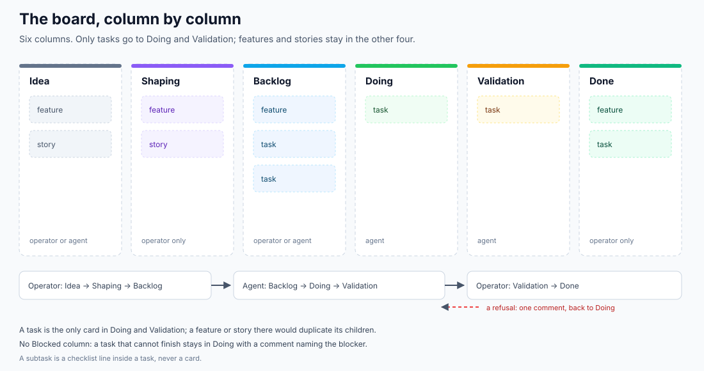

# Use the board

> **In one line.** The board answers "where is this work, and has anyone checked it?": a card's
> column is that answer, and only your last move makes anything accepted.
>
> **Use it when** filing a card, picking one up, or validating what an agent handed you ·
> **Verified** 2026-11-17 · **Kind:** living page

The board is Vikunja at [vikunja.kub.local](https://vikunja.kub.local), LAN only. It is the state of
the work; a plan is not. The rules — which column may hold what, who may move a card, what a card
carries and where it sits in its column — are the contract every session reads,
`~/.config/opencode/AGENTS.md` §Task board, with the long form on
[The board and worktrees](https://docs.kub.local/config/develop/agent/board-and-worktrees/). This
page is the walkthrough: what you will see, and what your own moves are.

## Columns

`Idea`, `Shaping`, `Backlog`, `Doing`, `Validation`, `Done`.



- **`Idea`** — a thought worth keeping, not a commitment.
- **`Shaping`** — decided it is worth doing, being cut into tasks. Yours: you move a card here; an
  agent leaves it alone.
- **`Backlog`** — cut, planned, not started. Position is the reading order.
- **`Doing`** — a session is working on it, or is blocked on it.
- **`Validation`** — the agent says it is finished; nobody has looked.
- **`Done`** — accepted. Only you move a card here.

Agents move tasks only: never a feature or story, never anything into `Done`. Only a task goes to
`Doing` or `Validation`; a feature or story stays in `Idea`, `Shaping`, `Backlog` or `Done`. A
finished task stops in `Validation`; one that cannot finish stays in `Doing` with a comment naming the
blocker — there is no blocked column.

## Three kinds of card

- **Feature** — a bundle of work with one reason to exist. Top level, no parent.
- **Story** — a slice of a feature a person would recognise. Child of a feature.
- **Task** — one session's work, one thing to validate. Child of a story, or of a feature with no
  stories.

The kind is one label per card. A subtask is a `- [ ]` line inside the description, never a card;
when a line later deserves tracking alone, somebody makes it a card by hand.

## Filing a card

A title in the imperative — *Rebuild the cross-seed chart* — and a description that opens with the
fixed block below, then the change and its evidence.

- One kind label, plus `implementer` or `reviewer` when a session played that role. Who wrote the
  card is the account, not a label.
- The parent, so a task sits under its story.
- The command and what it printed, not the claim it passed.
- A label for every file or pull request a reader might open; a URL inside backticks renders as
  inert text, so the link is written out.

Every card carries a `priority/*` label, and the column is ordered by it: a card sits above the first
card at or below its band, so the top is the next thing to read. The bands are in the contract; an
agent sets the label.

## Validating one

A card in `Validation` is a question: does it do what it says? Read the newest comment first, then
the description, then the plan it links. Run the check yourself rather than trusting the pasted
output.

Two outcomes. Accepted: move the card to `Done`. Refused: one comment saying what is wrong and what
would satisfy you, then a move back to `Doing`. That is the whole refusal, a comment and a move. Work
that needs its own session becomes a task in `Backlog` in the same breath.

## The fixed block

Every description opens with the same block, so the same facts sit in the same place:

```text
repo: [owner/repository](https://github.com/owner/repository)
docs: [Plan — <title>](https://github.com/owner/repository/blob/develop/docs/superpowers/plans/<plan>.md)
site: [Rendered page](https://docs.kub.local/homelab/develop/superpowers/plans/<plan>/)
branch: feature/<branch>
pr: [#<number>](https://github.com/owner/repository/pull/<number>)
```

- **`docs:`** is the GitHub URL, because an agent cannot get through the sign-in gate.
- **`site:`** is the same document rendered on the docs site: the file's path under `docs/`, less the
  `.md`, with a trailing slash, as the link *Rendered page*. Written only when the file is on
  `develop`, so a plan on an unmerged branch says `none`.
- **`branch:` and `pr:`** say `none` while they do not exist, so "no pull request" is
  distinguishable from "not filled in". A change that landed without one carries `commit:` instead.

The shapes to copy, and the rule behind them, are on
[The board and worktrees](https://docs.kub.local/config/develop/agent/board-and-worktrees/).

## The saved filters

Two saved filters read across the board. They are queues, not columns:

- **Needs my validation** — everything in `Validation`. Your review queue; the aim is that it
  empties.
- **Agent work in flight** — everything in `Doing`. It answers "what is anyone working on".

## What the board is not

- **Not a second todo list.** No markdown checklist in a report, no "remaining work" section
  consulted later. If it is work, it is a card.
- **Not the plan.** Plan checkboxes are ticked as an agent goes; a tick means planned and executed,
  never accepted. When a plan and the board disagree, the board wins.
- **Not where a decision lives.** A card links a decision; it does not contain one. Decisions are
  dated files under [`decisions/`](../decisions/README.md).
