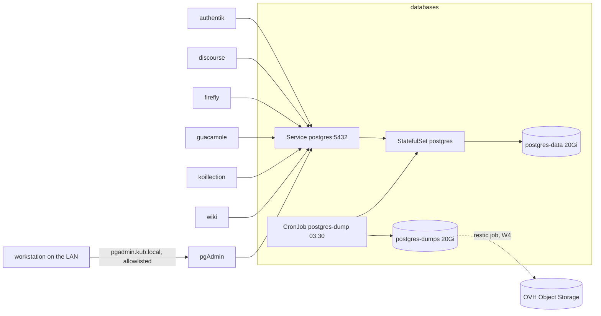

# Design — the shared PostgreSQL instance (W2)

- **Date:** 2026-11-13
- **Status:** draft for approval
- **Supersedes:** the W2 sketch in `2026-11-10-homelab-stabilisation-design.md` §W2 and the
  `postgres` row of `audit/argocd-helm.md` §3. It confirms the shape that sketch chose and fills in
  everything it left open.
- **Owner:** operator. Every decision marked **(operator)** was taken in conversation; every
  decision marked **(design)** is this document's call and can be overruled.

## 1. Intent

One PostgreSQL instance, in the cluster, serving every application that needs a relational
database. Small: nine databases at most, each in the tens to low hundreds of megabytes. It must be
boring to operate, safe to expose to the applications that need it, and recoverable to within one
day of data loss — and it must not become an obstacle if the database later moves to a dedicated
host outside the cluster.

Backup is designed now and built later. "Later" is allowed to mean "after this document", not
"after we need it".

## 2. What exists today, and why it is broken

Both objects are dead, not degraded. Nothing is recoverable.

| Object | State | Evidence |
|---|---|---|
| `postgres` | Bitnami chart `postgresql` 15.5.23, image `16.4.0-debian-12-r2` | `cluster/argocd/projects/databases/postgres.yaml` |
| | Pod cannot schedule: `nodeAffinity` requires `node-type: general` | `cluster/helm/databases/postgres/values.yaml:17-26`; the label is retired (§7 of the stabilisation design) |
| | Data claim `databases-postgres` was a Longhorn volume | `values.yaml:30`; `audit/observability-storage.md` §2.2 lists `postgres` among the losses |
| | Backup claim `databases-postgres-backup`, same fate | `values.yaml:41` |
| `pgadmin` | Application uses upstream `runix/pgadmin4` 1.50.0 while the in-repo chart is unused | `cluster/argocd/projects/databases/pgadmin.yaml`, `cluster/helm/databases/pgadmin/` |
| | Same retired `node-type` affinity; `existingClaim: pgadmin`, while the live claim was `pgadmin-pgadmin4` | `cluster/helm/databases/pgadmin/values.yaml:127`, `129-136` |
| | Ingress through `networking.k8s.io/v1` plus Traefik annotations | `values.yaml:34-48` — against the Traefik-CRD-only rule |

Consequence: there is no data to migrate, no dump to import, and no working backup anywhere. The
rebuild starts from empty, which is consistent with the eleven lost volumes being accepted as lost.

**Consumers today** (all already point at `postgres-postgresql.databases.svc.cluster.local`):

| App | Namespace | Database | Role | Credential source |
|---|---|---|---|---|
| authentik | `authentik` | `authentik` | `authentik` | `authentik-env` (`envFrom`) |
| discourse | `discourse` | `discourse` | `discourse` | `discourse` (`db-password`, `admin-db-password`) |
| firefly | `firefly` | `firefly` | `firefly` | `firefly-db` (`DB_DATABASE`, `DB_USERNAME`, `DB_PASSWORD`) |
| guacamole | `guacamole` | `guacamole` | `guacamole` | `guacamole-db` (`POSTGRES_USER`, `POSTGRES_PASSWORD`) |
| koillection | `koillection` | `koillection` | `koillection` | `koillection` (`DB_NAME`, `DB_HOST`, `DB_USER`, `DB_PASSWORD`) |
| wiki | `wiki` | `wikijs` | `wikijs` | `wikijs` (`password`) |

Postiz's bundled PostgreSQL is disabled (`cluster/helm/postiz/values.yaml:83-84`) but the chart sets
no database environment variables, so **its connection path is unverified** and it is not a
consumer until someone reads that chart properly. Ghostfolio and n8n keep no SQL database. Planned
future tenants: OpenMemory (needs `pgvector`) and Vikunja.

## 3. Goals, non-goals, anti-goals

**Goals**

1. A single PostgreSQL 18 primary in `databases`, one role and one database per application, no
   application holding superuser.
2. Reaching it requires being in the cluster and in an allow-listed namespace.
3. A nightly logical backup per database, verified, retained locally, and shipped offsite by the W4
   restic job once that exists.
4. Every database proven restorable into a scratch instance before the workstream is called done.
5. All of it declared in git: chart, SQL, CronJob, network policy, Application file.

**Non-goals**

1. High availability. No replica, no failover, no Patroni.
2. Point-in-time recovery. The operator accepts losing up to a day (stated 2026-11-13).
3. Per-application instances. One instance is the requirement.
4. TLS on port 5432 in this phase (see §6.7 for the risk and the revisit condition).
5. Moving off the cluster. §6.12 keeps the door open; it is not this workstream.

**Anti-goals — these would make it a failure even if it runs**

1. A shared superuser handed to applications because it was easier than per-app roles.
2. A backup job that has never been restored from.
3. A dump volume on the same filesystem as the data it protects.
4. Another Bitnami chart or image anywhere in the stack.
5. A component that only one person can explain (i.e. an operator for nine small databases).

## 4. Constraints

- Placement: `nodeSelector: kubernetes.io/hostname: nas`, per the placement map. The database is
  pinned; `local-path` ties its volume to that node anyway.
- Storage: `local-path` for configuration and data. NFS is for media, never for a database.
- Chart policy: owned chart (pattern A) — no upstream chart exists for a plain PostgreSQL.
- No application records `syncPolicy.automated`; the operator switches auto-sync in the ArgoCD UI.
- Files under `cluster/argocd/**` keep CRLF.
- Secrets are created by hand and never committed; their inventory lives in `docs/secrets.md`.
- Images: upstream or project-published only. `postgres` on Docker Hub is the single accepted
  exception, recorded in §8.7 of the stabilisation design.
- Current stable major is **18** (18.7, released 2026-11-12). PostgreSQL 19 was at RC2 on the same
  date, so 19 is not a candidate.
- K3s enforces `NetworkPolicy` through its kube-router controller unless `--disable-network-policy`
  was passed to the server. **[verify]** on `streaming` before relying on §6.7.

## 5. Approaches considered

**A. Plain StatefulSet on the official image, dump-based backup.** Selected.

- What it is: one `StatefulSet`, one `Service`, a `ConfigMap` of SQL, a `Job` that applies it, a
  `CronJob` that dumps, a `NetworkPolicy`. Roughly 400 lines of chart.
- Buys: nothing to learn beyond PostgreSQL and Kubernetes; every failure is visible in `kubectl`;
  restore is `pg_restore`.
- Costs: no failover beyond rescheduling on `nas`; upgrade and restore are runbook steps, not CRs.

**B. CloudNativePG operator.** Rejected.

- Would bring scheduled base backups, WAL shipping, `kubectl cnpg restore`, metrics, and a standby
  on another node as a one-field change.
- Costs an operator, five CRDs, its own image and its own upgrade path — and the features it
  sells (instant recovery, automatic failover) are precisely the ones a 24-hour loss budget does
  not need. Adding it later remains possible; it is a migration, not a rebuild, because the data
  format is the same.

**C. Dedicated host outside the cluster now.** Rejected for this phase.

- Matches the eventual direction. Rejected because it puts a second machine to patch, secure and
  back up into a rebuild that is not finished, before there is any load that justifies it.

**Decision (operator, 2026-11-13): A.** Reasons: smallest thing that meets a one-day loss budget,
consistent with the already-approved W2 sketch, and it does not close off C — see §6.12.

## 6. The design

### 6.1 Shape

One owned chart at `cluster/helm/databases/postgres/`, replacing the values-only directory that
exists today. Objects it renders:

| Object | Purpose |
|---|---|
| `StatefulSet/postgres` | one pod, `Recreate` semantics, data claim on `local-path` |
| `Service/postgres` | ClusterIP, port 5432 — the only name applications use |
| `Service/postgres-headless` | required by `StatefulSet.spec.serviceName`; no consumers |
| `ConfigMap/postgres-init` | the SQL that creates roles, databases and extensions |
| `Job/postgres-init` | applies that SQL, idempotent, runs on every sync where the ConfigMap changed |
| `CronJob/postgres-dump` | nightly per-database dumps into a separate claim |
| `NetworkPolicy/postgres` | default-deny ingress in `databases`, then allow 5432 from the consumer namespaces |
| `ConfigMap/postgres-config` | `postgresql.conf` overrides, mounted and included |

Not rendered, created by hand: `Secret/postgres-superuser` (see §6.6).

Application file: `cluster/argocd/projects/databases/postgres.yaml` switches from the
multi-source Bitnami form (pattern B) to a local `path:` — the same shape as `media-stack/sonarr`.



### 6.2 Image and version

`postgres:18.7`, pinned by digest. **(design)**

- Plain official image, not `pgvector/pgvector`, even though OpenMemory will need the extension.
  Reason: the component everything depends on should change one thing at a time; adding an
  extension to an image is a restart with the same major version and the same on-disk format, so
  it is a cheap later step, not a migration.
- The swap, when OpenMemory is built: `pgvector/pgvector:0.8.7-pg18` (same PostgreSQL, the
  extension compiled in), then `CREATE EXTENSION vector` in that one database. No dump/reload.
- Digest pinning, not just the tag: `postgres:18.7` resolves to a moving digest on Docker Hub.
  Renovate can bump the digest line.

### 6.3 Storage and sizing

| Claim | Size | Class | Holds |
|---|---|---|---|
| `postgres-data` | 20 Gi | `local-path` | `PGDATA` |
| `postgres-dumps` | 20 Gi | `local-path` | 14 days of dumps |

Two claims on purpose: a dump that fills its volume must never be able to take the database down.

Sizing for the stated workload (≤9 databases, ≤1 GiB total):

| Setting | Value | Why |
|---|---|---|
| CPU request / limit | 100m / 1 | idle most of the day; bursts on app migrations |
| Memory request / limit | 512Mi / 1Gi | fits the working set of a sub-gigabyte dataset |
| `shared_buffers` | 256MB | ~25 % of the memory limit — the classic starting point |
| `effective_cache_size` | 768MB | tells the planner what the OS can cache |
| `max_connections` | 60 | six to nine apps at a handful of connections each |
| `work_mem` | 8MB | per sort/hash node; 60 connections × a few nodes stays inside 1 GiB |
| `maintenance_work_mem` | 64MB | vacuum and index builds |
| `log_min_duration_statement` | 1000ms | surfaces slow queries without a log flood |

These numbers assume the workload stays small. The measurement that would change them is
`pg_database_size` summed across databases plus the memory high-water mark from the metrics
exporter; if that crosses ~2 GiB, raise the limit before the buffers.

### 6.4 Container and lifecycle

- `strategy: Recreate` behaviour with one replica: `StatefulSet` update strategy `RollingUpdate`,
  a single pod, `terminationGracePeriodSeconds: 120` so a fast shutdown completes.
- Probes are `exec` (`pg_isready -U postgres -h 127.0.0.1`), not HTTP/TCP: `NetworkPolicy` may
  block node-sourced health checks depending on the CNI, and `exec` probes are unaffected.
  Startup probe budget 60s; readiness 10s; liveness 20s with 3 failures.
- `securityContext`: `runAsUser: 999` (the `postgres` user in the official image),
  `fsGroup: 999`, `allowPrivilegeEscalation: false`, all capabilities dropped,
  `seccompProfile: RuntimeDefault`. The root filesystem stays writable — PostgreSQL writes sockets
  and a lock file under `/var/run/postgresql`, and a read-only root would need three emptyDirs to
  buy nothing.
- No `initContainer` games. `PGDATA` lives at `/var/lib/postgresql/data` on the claim; the official
  image initialises it on first start with `POSTGRES_PASSWORD` from `postgres-superuser`.

### 6.5 Roles and databases

Six databases, each owned by its own role. Created by `ConfigMap/postgres-init` and applied by
`Job/postgres-init` — no hand-run SQL, no superuser for applications.

```sql
-- pattern per application; x is the database, also the role name
SELECT 'CREATE ROLE x LOGIN PASSWORD ' || quote_literal(current_setting('app.pw_x'))
 WHERE NOT EXISTS (SELECT FROM pg_roles WHERE rolname = 'x')\gexec
SELECT 'CREATE DATABASE x OWNER x'
 WHERE NOT EXISTS (SELECT FROM pg_database WHERE datname = 'x')\gexec
REVOKE ALL ON DATABASE x FROM PUBLIC;
GRANT CONNECT ON DATABASE x TO x;
```

Rules the job enforces:

- Every role is `NOSUPERUSER NOCREATEROLE NOCREATEDB NOREPLICATION`.
- `REVOKE CONNECT ON DATABASE ... FROM PUBLIC` on every database, including `postgres`. An
  application that guesses another's database name still cannot connect.
- The role owns its database and nothing else. `template1` is untouched, so new databases do not
  inherit grants.
- `CONNECT` for the backup role, which is `pg_read_all_data` and therefore can dump everything
  without being superuser: `CREATE ROLE backup LOGIN; GRANT pg_read_all_data TO backup;`
  Passwords arrive as environment variables read from Secrets; **no password is ever written into
  the ConfigMap or the chart**.
- Re-running the job changes nothing. That is what makes it safe to run on every sync.

`pg_hba.conf` (rendered by the chart into `PGDATA` via `POSTGRES_HOST_AUTH_METHOD` defaults + an
explicit `pg_hba` ConfigMap): `scram-sha-256` for all `host` lines, `local` peer for the `postgres`
superuser only, no `trust` anywhere.

### 6.6 Secrets

Two levels, matching §8.5 of the stabilisation design (inventory plus encrypted dump, SOPS later).

| Secret | Namespace | Keys | Consumer |
|---|---|---|---|
| `postgres-superuser` | `databases` | `postgres-password` | the pod; nobody else |
| `pg-backup` | `databases` | `backup-password` | `CronJob/postgres-dump` |
| `pg-<app>` | `databases` | `password` | `Job/postgres-init` only |
| `<app>-db` / `authentik-env` / `discourse` / `koillection` / `wikijs` | the app's namespace | as today (see §2 table) | the application |

A Kubernetes Secret is namespaced, so one password necessarily exists twice: once in `databases`
where the role is created, once in the application's namespace where it is consumed. The copy is
recorded in `docs/secrets.md` as a pair, with a single rotation procedure: update both, then
`ALTER ROLE ... PASSWORD`. Rejected alternatives: a reflector or external-secrets controller (an
operator to avoid a copy-paste), or letting applications create their own roles (a superuser in
every namespace).

The existing application Secrets keep their names and keys, so no consumer chart changes shape —
only the hostname and, where the value was a leftover, the password.

### 6.7 Network and exposure

- No `Ingress`/`IngressRoute` for 5432, and the Service is `ClusterIP`: no `LoadBalancer`, no
  `NodePort`, no host port. Nothing outside the cluster can open a database connection in this
  phase, and that is a property of the object, not of a firewall someone has to remember.
- `NetworkPolicy/postgres`: deny all ingress in `databases`, then allow TCP 5432 from pods in
  `authentik`, `discourse`, `firefly`, `guacamole`, `koillection`, `wiki` (selected by
  `namespaceSelector` on `kubernetes.io/metadata.name`), and from the pgAdmin pod inside
  `databases` itself (selected by `podSelector` on `app: pgadmin`). Egress stays default-allowed so
  DNS and the dump job work.
- No TLS on 5432. **Accepted risk, stated plainly:** between `nas` (database) and `nuc0` (most
  applications), credentials and query traffic cross the physical LAN in clear text. The
  mitigations are the network policy, the LAN being a switched home network, and no exposure
  outside the cluster. There is no cert-manager in the cluster, so in-cluster TLS would mean
  hand-rolled certificates and a manual renewal nobody would do — worse than the risk it removes.
  Revisit if the database ever leaves `nas`, or if the cluster gets a certificate authority for
  another reason.

### 6.8 Backup

Nightly, 03:30, `CronJob/postgres-dump` as role `backup`:

1. For each database in a list held in a ConfigMap: `pg_dump -Fc -Z6 -d <db> -f /dumps/<db>-<UTC
   date>.dump`.
2. Verify each file with `pg_restore --list` — catches a truncated or empty dump the same night,
   which is the failure mode a dump job usually has.
3. Delete dumps older than 14 days.
4. Exit non-zero if any step failed, so the `Job` object is the visible record.

`pg_dumpall --globals-only` is **not** run: roles are SQL in git and reproducible.

The 14 local dumps are the recoverable copy in this phase. Offsite is W4: restic copies
`/dumps` (and the app config volumes) to OVH Object Storage with 7 daily / 4 weekly / 12 monthly
retention. **Until that job exists, the one-day loss guarantee holds only for a pod or node
failure that leaves `nas`'s disk intact.** A disk loss on `nas` still loses everything. This is the
single most important sentence in this document and it is why the workstream must not be called
complete before W4.

Why no copy of `PGDATA`: a file-level copy of a running data directory is not crash-consistent,
and a stopped copy of 20 GiB buys nothing a 50 MB dump does not, at this size. If the instance ever
grows past what a dump restores in a reasonable window, that decision changes.

### 6.9 Restore and drills

The procedure, also written as `docs/runbooks/postgres-restore.md`:

1. Create a scratch instance: a temporary `StatefulSet` from the same chart with its own empty
   claim, or `docker run postgres:18.7` on a workstation. Scratch means *not* the production
   Service name.
2. `pg_restore -d <db> --no-owner --role=<role> /dumps/<db>-<date>.dump`.
3. Check row counts against the source for two or three tables, and start the application against
   the scratch instance if the check is cheap.
4. Delete the scratch instance.

Acceptance is one drill per database, recorded in the runbook with a date. A drill that has never
been run is why the old setup looked fine until it was needed.

Alerting (added in Grafana, where alert rules live): dump file older than 26 hours, database pod
not ready, data volume above 85 %, `postgres_exporter` `pg_up == 0`.

### 6.10 Observability

Sidecar `prometheus-community/postgres-exporter` pinned, scraping the local socket, plus
`prometheus.io/scrape: "true"` pod annotations — the mechanism Prometheus actually uses here, not
`ServiceMonitor`. Two dashboards' worth of panels come free: connections, transactions, cache hit
ratio, database sizes, replication lag (always zero, deliberately).

### 6.11 pgAdmin

**Kept (operator, 2026-11-13).** Reason given: it is how the operator inspects the databases, and
`kubectl exec` plus `psql` is a worse answer than a browser. The shape below is the design's job.

- Owned wrapper chart in `cluster/helm/databases/pgadmin/` around `runix/pgadmin4`, pinned to an
  exact version — pattern D, the same shape as the monitoring wrappers. The in-repo chart that
  exists today becomes the real source instead of dead weight.
- `local-path` claim, `nodeSelector` on `nuc0` (it is an admin tool, not storage-bound), no
  `node-type` affinity.
- **Local network only (operator).** IngressRoute on the `web` entrypoint with host
  `pgadmin.kub.local`, plus a Traefik `IPAllowList` middleware pinned to the home LAN CIDR
  (`192.168.1.0/24` today — the same LAN `plex` trusts; confirm the subnet when writing it). No
  public hostname, no `myresolver`, no exposure through the public entrypoint. Container port 80
  stays inside the cluster.
- **Two connections, different privileges.** The everyday connection uses the read-only `backup`
  role (`pg_read_all_data`): enough for browsing tables, plans and queries, and it cannot change
  anything. The `postgres` superuser is registered as a separate server entry used only for
  administration, and its password is **never saved** in pgAdmin's config. Saved passwords for the
  read-only role are allowed and are encrypted with pgAdmin's master password; that master password
  is not stored anywhere in the cluster.
- Its own configuration database is backed up with the `nuc0` config volumes (W4), not with the
  PostgreSQL dumps. `docs/secrets.md` records that this volume therefore contains encrypted
  database credentials, which the W4 backup inherits.
- The PostgreSQL dump/restore path never depends on pgAdmin. Losing it costs a UI, not access.

Rejected alternative: deleting it and using `psql` or a desktop client over `kubectl port-forward`.
Cheaper in pods, worse in practice for the operator's actual use.

### 6.12 The future dedicated node

What this design does to keep that door open, and nothing more:

- Applications address the database by one DNS name, `postgres.databases.svc.cluster.local`. If the
  database moves out, that Service becomes an `ExternalName` (or its selector points at an
  `EndpointSlice`), and no application chart changes — only the network path and its firewall.
- No application stores a cluster-internal address other than that name.
- The data is portable by construction: logical dumps are the backup format, so the move is
  dump → restore into the new host → repoint the Service.
- Node pinning means today's failure domain is one node, which is the same failure domain a
  dedicated host would have minus the extra machine to patch.

### 6.13 Upgrades

- Minor versions: bump the digest in `values.yaml`, sync, done. The pod restarts.
- Major versions: dump, restore into a new claim, swap — the same drill as §6.9, which is why the
  drill is an acceptance criterion. No `pg_upgrade` gymnastics in a pod that has no room for a
  second `PGDATA`.

## 7. The consumers are W3's work, not this workstream's

**Decision (operator, 2026-11-13): W2 does not edit a single consumer chart.** It owns the
database side and proves it works; W3 repoints the applications when it rebuilds them anyway.

Why: five of the six consumer charts pin themselves to the retired `node-type` label
(`wiki/values.yaml:81-89`, `firefly/values.yaml:82-89`, `guacamole/values.yaml:81-89`,
`koillection/values.yaml:81-89`, and authentik's wrapper values). A hostname change rolls the pod,
and the new pod cannot schedule. On top of that, `discourse`'s and `koillection`'s claims were
deleted with Longhorn, so neither can start until W3 Wave A rebuilds them. Repointing them here
would mean shipping changes that are known-broken on arrival.

What W2 does instead, per database: run a throwaway client pod **in each consumer's namespace**,
with that consumer's role and the Service name, and prove it connects, reads and writes. That is
the property the database is responsible for. The one-line host changes are then a W3 task with a
recorded starting point:

| Chart | Change (W3) |
|---|---|
| authentik | `authentik.postgresql.host` → `postgres.databases.svc.cluster.local` |
| discourse | `externalDatabase.host`; `create: true` becomes `false` (the init job creates role and database) |
| firefly | `DB_HOST` value |
| guacamole | `POSTGRES_HOSTNAME` value |
| koillection | `DB_HOST` comes from its Secret — update the Secret, not the chart |
| wiki | `DB_HOST` value |

Also W3's, because they are what actually blocks those pods: the five `node-type` affinities, and
the two deleted claims. Recording them here so the handover is explicit rather than discovered.

## 8. Order of work

0. This workstream runs after W1's three broken-reference repairs, because acceptance depends on
   the repository being coherent. Nothing in the chart itself depends on W1.

1. Chart and Application file; `databases` namespace created by the Application.
2. Secrets: `postgres-superuser`, `pg-backup`, `pg-<app>` × 6, and the copies in each app's
   namespace (the apps read their own; the init job reads the `databases` copies). Inventory first,
   in `docs/secrets.md`.
3. First sync: pod starts, init job creates roles and databases, `\l` shows six databases.
4. Per database, a throwaway client pod in the consumer's namespace connects with that consumer's
   role, creates a table, writes, reads and drops it. No consumer chart is touched (§7).
5. `NetworkPolicy` enabled last, after every connection test passes, so a policy typo is diagnosed
   against a working baseline rather than a broken one.
6. Dump CronJob, then a restore drill per database.
7. Grafana alerts, including the dump-age alert W4 depends on.
8. pgAdmin: wrapper chart, LAN-only ingress, read-only connection. Delete the old Application
   wiring and the dead claim reference in the same pass.

## 9. Acceptance

1. `kubectl -n databases get statefulset,job,pod` all healthy, and six databases exist.
2. For each of the six, a throwaway pod in the consumer's namespace connects with that app's role,
   writes and reads a row. `\du` shows six unprivileged roles plus `backup`, and no application
   holding superuser.
3. A connection attempt from a namespace outside the allow-list (e.g. a test pod in `default`)
   fails to open 5432.
4. From a workstation on the LAN, `pgadmin.kub.local` loads; from the public name or from outside
   the LAN, it does not; and 5432 is not reachable from outside the cluster at all.
5. The dump CronJob produced six files tonight, each `pg_restore --list`-clean.
6. Each database restored into a scratch instance, dated in `docs/runbooks/postgres-restore.md`.
7. No Bitnami artefact anywhere: no `postgresql` chart in any Application, no `postgres-secrets`
   Secret referenced.
8. `helm template` renders the chart clean, and the two repo reference-integrity checks in
   `AGENTS.md` §6 report nothing caused by this workstream. (They currently report two known
   failures on `nfs` paths, both W1's to fix; those are out of scope here and are excluded from
   this criterion.)

## 10. Risks and open items

| Risk | Mitigation |
|---|---|
| `nas` disk loss before W4 ships loses everything | stated, not solved; W4 is the fix, and the workstream is not complete without it |
| `nas` is a single point of failure with no failover | accepted; a 24-hour loss budget does not buy a standby |
| Clear-text 5432 traffic on the LAN | network policy + no external exposure; revisit if the DB moves out |
| K3s `NetworkPolicy` enforcement disabled | **[verify]** `--disable-network-policy` is absent before relying on §6.7. If enforcement is off: ship the policy anyway (inert but correct), record the acceptance amendment for §9.3, and put enabling enforcement in W5 with the platform upgrades — restarting control-plane servers is not part of this workstream. |
| `postgres:18.7` digest moves | pinned by digest, Renovate bumps it |
| Postiz's real connection path is unverified | read that chart before treating it as a consumer; it is not in scope here |
| pgAdmin is a UI that reaches every database | everyday connection is the read-only `backup` role; the superuser password is never saved in it; LAN-only IP allowlist; its config volume (with encrypted credentials) is part of the W4 backup set |

## 11. Left to the builder

- Exact chart file layout and helper templates; whether the init SQL lives in one file or one per
  database (one file is fine at this size).
- Whether `Job/postgres-init` is a Helm hook or a plain Job with the ConfigMap checksum in its
  annotations. A plain Job with a checksum annotation is simpler under ArgoCD and is the
  recommendation.
- `pg_hba.conf` rendering details and whether `POSTGRES_INITDB_ARGS` is needed for
  `--data-checksums` (recommended: yes, it is free and catches corruption).
- Metrics exporter port, alert thresholds beyond the four named.
- The pgAdmin wrapper chart: how the `runix` chart is wrapped, whether the `IPAllowList` middleware
  lives in the chart or in `cluster/infrastructure/`, and the exact LAN CIDR to allow.
- The runbook wording for the drill.
