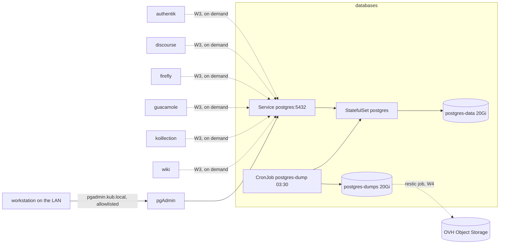

# Design — the shared PostgreSQL instance (W2)

- **Date:** 2026-11-13
- **Status:** approved (operator, 2026-11-13), with the revisions of the same day: no pre-created
  databases, no `pgvector`, an admin login on pgAdmin.
- **Supersedes:** the W2 sketch in `2026-11-10-homelab-stabilisation-design.md` §W2 and the
  `postgres` row of `audit/argocd-helm.md` §3. It confirms the shape that sketch chose and fills in
  everything it left open.
- **Owner:** operator. Every decision marked **(operator)** was taken in conversation; every
  decision marked **(design)** is this document's call and can be overruled.

## 1. Intent

One PostgreSQL instance, in the cluster, serving every application that needs a relational
database. Small: nine databases at most, each in the tens to low hundreds of megabytes. It must be
boring to operate, safe to expose to the applications that need it, and recoverable to within one
day of data loss — and it must not become an obstacle if the database later moves to a dedicated
host outside the cluster.

Backup is designed now and built later. "Later" is allowed to mean "after this document", not
"after we need it".

## 2. What exists today, and why it is broken

Both objects are dead, not degraded. Nothing is recoverable.

| Object | State | Evidence |
|---|---|---|
| `postgres` | Bitnami chart `postgresql` 15.5.23, image `16.4.0-debian-12-r2` | `cluster/argocd/projects/databases/postgres.yaml` |
| | Pod `postgres-postgresql-0` has been `Pending` for 95 days. The scheduler's own reason, from the event of 2026-09-30: `persistentvolumeclaim "databases-postgres2" not found`. No claim named `databases-postgres*` exists in the namespace. | `kubectl -n databases describe pod postgres-postgresql-0` |
| | Git asks for `existingClaim: databases-postgres`, the live pod asks for `databases-postgres2` — drift on top of the loss. The claim was a Longhorn volume either way. | `values.yaml:30`; `audit/observability-storage.md` §2.2 |
| | Backup claim `databases-postgres-backup`, same fate | `values.yaml:41` |
| `pgadmin` | Application uses upstream `runix/pgadmin4` 1.50.0 while the in-repo chart is unused | `cluster/argocd/projects/databases/pgadmin.yaml`, `cluster/helm/databases/pgadmin/` |
| | Still running (`pgadmin-pgadmin4-6779457bd9`, 92 days, on `nas`) on a 10 Gi Longhorn claim that is `Terminating` — it lives until that pod restarts | `kubectl -n databases get pvc` |
| | `existingClaim: pgadmin` in git, while the live claim is `pgadmin-pgadmin4` | `cluster/helm/databases/pgadmin/values.yaml:127` |
| | Ingress through `networking.k8s.io/v1` plus Traefik annotations | `values.yaml:34-48` — against the Traefik-CRD-only rule |

Verified against the live cluster on 2026-11-13, which corrects two things this document first assumed:

- **The `node-type` label still exists on the nodes** (`nas`→`nas`, `nuc0`→`general`, `rbp2`→`small`, `streaming`→`computing`). It is retired from charts by decision, not removed from the machines. The affinity in the Bitnami values is therefore *not* why that pod is stuck; the missing claim is.
- **`pgadmin-pgadmin4` is a live, `Terminating` claim.** A new chart that reproduces that name cannot create it. The replacement uses its own claim name (§6.11), and the old one is cleared by hand like the other Longhorn leftovers.

Consequence: there is no data to migrate, no dump to import, and no working backup anywhere. The
rebuild starts from empty, which is consistent with the eleven lost volumes being accepted as lost.

**Expected consumers** (all already point at `postgres-postgresql.databases.svc.cluster.local`).
None of them gets a database in this workstream; each one gets its role and database from the §6.5
procedure when its application is rebuilt in W3. The table is the inventory of names to expect, and
the record of which Secret holds each password:

| App | Namespace | Database | Role | Credential source |
|---|---|---|---|---|
| authentik | `authentik` | `authentik` | `authentik` | `authentik-env` (`envFrom`) |
| discourse | `discourse` | `discourse` | `discourse` | `discourse` (`db-password`, `admin-db-password`) |
| firefly | `firefly` | `firefly` | `firefly` | `firefly-db` (`DB_DATABASE`, `DB_USERNAME`, `DB_PASSWORD`) |
| guacamole | `guacamole` | `guacamole` | `guacamole` | `guacamole-db` (`POSTGRES_USER`, `POSTGRES_PASSWORD`) |
| koillection | `koillection` | `koillection` | `koillection` | `koillection` (`DB_NAME`, `DB_HOST`, `DB_USER`, `DB_PASSWORD`) |
| wiki | `wiki` | `wikijs` | `wikijs` | `wikijs` (`password`) |

Postiz's bundled PostgreSQL is disabled (`cluster/helm/postiz/values.yaml:83-84`) but the chart sets
no database environment variables, so **its connection path is unverified** and it is not a
consumer until someone reads that chart properly. Ghostfolio and n8n keep no SQL database. Planned
future tenants: OpenMemory (needs `pgvector`) and Vikunja.

## 3. Goals, non-goals, anti-goals

**Goals**

1. A single PostgreSQL 18 primary in `databases`, serving one non-superuser role per application.
   **Databases are created on demand, one at a time, when an application is rebuilt — not in
   advance and not by a batch job** (operator, 2026-11-13). The instance starts with its superuser,
   the read-only `backup` role and the `postgres_exporter` metrics role, and nothing else.
2. Reaching it requires being in the cluster and in an allow-listed namespace.
3. A nightly logical backup of every database that exists, verified, retained locally, and shipped
   offsite by the W4 restic job once that exists.
4. The add-a-database procedure and the restore procedure both proven, on a scratch database,
   before the workstream is called done.
5. All of it declared in git: chart, SQL, CronJob, network policy, Application file.

**Non-goals**

1. High availability. No replica, no failover, no Patroni.
2. Point-in-time recovery. The operator accepts losing up to a day (stated 2026-11-13).
3. Per-application instances. One instance is the requirement.
4. TLS on port 5432 in this phase (see §6.7 for the risk and the revisit condition).
5. Moving off the cluster. §6.12 keeps the door open; it is not this workstream.
6. The `pgvector` extension (operator, 2026-11-13). If OpenMemory ever needs it, that is a separate
   change with its own image and its own risk — not a silent part of this one.

**Anti-goals — these would make it a failure even if it runs**

1. A shared superuser handed to applications because it was easier than per-app roles.
2. A backup job that has never been restored from.
3. A dump volume on the same filesystem as the data it protects.
4. Another Bitnami chart or image anywhere in the stack.
5. A component that only one person can explain (i.e. an operator for nine small databases).

## 4. Constraints

- Placement: `nodeSelector: kubernetes.io/hostname: nas`, per the placement map. The database is
  pinned; `local-path` ties its volume to that node anyway.
- Storage: `local-path` for configuration and data. NFS is for media, never for a database.
- Chart policy: owned chart (pattern A) — no upstream chart exists for a plain PostgreSQL.
- No application records `syncPolicy.automated`; the operator switches auto-sync in the ArgoCD UI.
- Files under `cluster/argocd/**` keep CRLF.
- Secrets are created by hand and never committed; their inventory lives in `docs/secrets.md`.
- Images: upstream or project-published only. `postgres` on Docker Hub is the single accepted
  exception, recorded in §8.7 of the stabilisation design.
- Current stable major is **18** (18.7, released 2026-11-12). PostgreSQL 19 was at RC2 on the same
  date, so 19 is not a candidate.
- K3s enforces `NetworkPolicy` through its kube-router controller unless `--disable-network-policy`
  was passed to the server. **[verify]** on `streaming` before relying on §6.7.

## 5. Approaches considered

**A. Plain StatefulSet on the official image, dump-based backup.** Selected.

- What it is: one `StatefulSet`, one `Service`, a `ConfigMap` of SQL, a `Job` that applies it, a
  `CronJob` that dumps, a `NetworkPolicy`. Roughly 400 lines of chart.
- Buys: nothing to learn beyond PostgreSQL and Kubernetes; every failure is visible in `kubectl`;
  restore is `pg_restore`.
- Costs: no failover beyond rescheduling on `nas`; upgrade and restore are runbook steps, not CRs.

**B. CloudNativePG operator.** Rejected.

- Would bring scheduled base backups, WAL shipping, `kubectl cnpg restore`, metrics, and a standby
  on another node as a one-field change.
- Costs an operator, five CRDs, its own image and its own upgrade path — and the features it
  sells (instant recovery, automatic failover) are precisely the ones a 24-hour loss budget does
  not need. Adding it later remains possible; it is a migration, not a rebuild, because the data
  format is the same.

**C. Dedicated host outside the cluster now.** Rejected for this phase.

- Matches the eventual direction. Rejected because it puts a second machine to patch, secure and
  back up into a rebuild that is not finished, before there is any load that justifies it.

**Decision (operator, 2026-11-13): A.** Reasons: smallest thing that meets a one-day loss budget,
consistent with the already-approved W2 sketch, and it does not close off C — see §6.12.

## 6. The design

### 6.1 Shape

One owned chart at `cluster/helm/databases/postgres/`, replacing the values-only directory that
exists today. Objects it renders:

| Object | Purpose |
|---|---|
| `StatefulSet/postgres` | one pod, `Recreate` semantics, data claim on `local-path` |
| `PersistentVolumeClaim/postgres-data` | 20 Gi, `local-path`, mounted by the StatefulSet |
| `PersistentVolumeClaim/postgres-dumps` | 20 Gi, `local-path`, mounted by the dump job |
| `Service/postgres` | ClusterIP, port 5432 — the only name applications use |
| `Service/postgres-headless` | required by `StatefulSet.spec.serviceName`; no consumers |
| `ConfigMap/postgres-bootstrap` | first-boot SQL: the read-only `backup` role, `REVOKE CONNECT` on `postgres` |
| `Job/postgres-bootstrap` | applies it once; idempotent, safe to re-run |
| `CronJob/postgres-dump` | nightly dumps of every database into a separate claim |
| `NetworkPolicy/postgres` | default-deny ingress in `databases`, then allow 5432 from the consumer namespaces |
| `ConfigMap/postgres-config` | `postgresql.conf` overrides, mounted and included |

Not rendered, created by hand: `Secret/postgres-superuser` (see §6.6).

Application file: `cluster/argocd/projects/databases/postgres.yaml` switches from the
multi-source Bitnami form (pattern B) to a local `path:` — the same shape as `media-stack/sonarr`.



### 6.2 Image and version

`postgres:18.7`, pinned by digest. **(design)**

- Plain official image. No extension is added, `pgvector` included in that refusal (operator,
  2026-11-13). The image is the upstream one, the tag is the current minor, and the digest is
  pinned because `postgres:18.7` resolves to a moving digest on Docker Hub. Renovate can bump the
  digest line.
- Nothing is pre-enabled either. `CREATE EXTENSION` in a database is a decision made when an
  application needs it, not a default.

### 6.3 Storage and sizing

| Claim | Size | Class | Holds |
|---|---|---|---|
| `postgres-data` | 20 Gi | `local-path` | `PGDATA` |
| `postgres-dumps` | 20 Gi | `local-path` | 14 days of dumps |

Two claims on purpose: a dump that fills its volume must never be able to take the database down.
`local-path` is `WaitForFirstConsumer` (verified live), so both stay `Pending` until a pod that
mounts them is scheduled — that is normal, not a fault to chase.

Sizing for the stated workload (≤9 databases, ≤1 GiB total):

| Setting | Value | Why |
|---|---|---|
| CPU request / limit | 100m / 1 | idle most of the day; bursts on app migrations |
| Memory request / limit | 512Mi / 1Gi | fits the working set of a sub-gigabyte dataset |
| `shared_buffers` | 256MB | ~25 % of the memory limit — the classic starting point |
| `effective_cache_size` | 768MB | tells the planner what the OS can cache |
| `max_connections` | 60 | six to nine apps at a handful of connections each |
| `work_mem` | 8MB | per sort/hash node; 60 connections × a few nodes stays inside 1 GiB |
| `maintenance_work_mem` | 64MB | vacuum and index builds |
| `log_min_duration_statement` | 1000ms | surfaces slow queries without a log flood |

These numbers assume the workload stays small. The measurement that would change them is
`pg_database_size` summed across databases plus the memory high-water mark from the metrics
exporter; if that crosses ~2 GiB, raise the limit before the buffers.

### 6.4 Container and lifecycle

- `strategy: Recreate` behaviour with one replica: `StatefulSet` update strategy `RollingUpdate`,
  a single pod, `terminationGracePeriodSeconds: 120` so a fast shutdown completes.
- Probes are `exec` (`pg_isready -U postgres -h 127.0.0.1`), not HTTP/TCP: `NetworkPolicy` may
  block node-sourced health checks depending on the CNI, and `exec` probes are unaffected.
  Startup probe budget 60s; readiness 10s; liveness 20s with 3 failures.
- `securityContext`: `runAsUser: 999` (the `postgres` user in the official image),
  `fsGroup: 999`, `allowPrivilegeEscalation: false`, all capabilities dropped,
  `seccompProfile: RuntimeDefault`. The root filesystem stays writable — PostgreSQL writes sockets
  and a lock file under `/var/run/postgresql`, and a read-only root would need three emptyDirs to
  buy nothing.
- No `initContainer` games. `PGDATA` lives at `/var/lib/postgresql/data` on the claim; the official
  image initialises it on first start with `POSTGRES_PASSWORD` from `postgres-superuser`.

### 6.5 Roles and databases, created on demand

**Decision (operator, 2026-11-13): no database is created ahead of its application.** The instance
comes up with three roles — the `postgres` superuser, the read-only `backup` role, and
`postgres_exporter` for metrics — and exactly the databases the official image creates (`postgres`,
`template0`, `template1`). Everything else is added when an application needs it, through a
documented procedure, so the operator sees each one appear and knows what it is for.

**Bootstrap (once, in the chart).** `Job/postgres-bootstrap` runs SQL from a ConfigMap:

```sql
-- read-only dumping role; password comes from the Secret, never from this file
CREATE ROLE backup LOGIN PASSWORD :'backup_password';
GRANT pg_read_all_data TO backup;

-- metrics role: sees statistics, cannot read table data
CREATE ROLE postgres_exporter LOGIN PASSWORD :'exporter_password';
GRANT pg_monitor TO postgres_exporter;
GRANT CONNECT ON DATABASE postgres TO postgres_exporter;

REVOKE CONNECT ON DATABASE postgres FROM PUBLIC;

-- after the revoke, deliberately: the dump script excludes postgres from the
-- databases it dumps and needs CONNECT only to run its database-list query
-- against postgres, so it needs its own grant once PUBLIC has none
GRANT CONNECT ON DATABASE postgres TO backup;
```

Guarded with `WHERE NOT EXISTS (SELECT FROM pg_roles WHERE rolname = '…')\gexec` so a re-run is a
no-op. The `REVOKE` is what stops an application that guesses `postgres` from connecting. The
exporter role exists because scraping over the local socket would need `peer`/`trust` auth for a
second operating-system user, which breaks the no-`trust` rule; it connects over TCP like everything
else.

**On demand — `docs/runbooks/postgres-add-database.md`.** One procedure, run when an application is
rebuilt, producing the same shape every time:

1. Generate a password and create two Secrets: `pg-<app>` in `databases` and the app's own secret
   in its namespace (same value; recorded as a pair in `docs/secrets.md`).
2. Run the SQL as the superuser, from a `psql` session in the pod or from pgAdmin:

```sql
CREATE ROLE <app> LOGIN PASSWORD '<from the secret>' NOSUPERUSER NOCREATEROLE NOCREATEDB NOREPLICATION;
CREATE DATABASE <app> OWNER <app>;
REVOKE ALL ON DATABASE <app> FROM PUBLIC;
GRANT CONNECT ON DATABASE <app> TO <app>;
GRANT CONNECT ON DATABASE <app> TO backup;
```

3. Prove it: connect as `<app>` from a pod in the application's namespace, create a table, write,
   read, drop it.
4. Note the date and the application in the runbook's log table.

The rules the procedure encodes, so they hold whether it is run by hand or later automated: no
role is ever superuser or can create databases; `CONNECT` is revoked from `PUBLIC` on every
database, so guessing another application's database name does not get a connection; the role owns
its own database and nothing else; `template1` is untouched, so new databases inherit no grants;
`backup` gets `CONNECT` so the dump job covers new databases without anyone remembering to update
it.

This is deliberately less automated than a batch job, and it is the trade the operator asked for:
a database exists because someone needed it, not because a list said so.

`pg_hba.conf` (rendered by the chart into `PGDATA` via `POSTGRES_HOST_AUTH_METHOD` defaults + an
explicit `pg_hba` ConfigMap): `scram-sha-256` for all `host` lines, `local` peer for the `postgres`
superuser only, no `trust` anywhere.

### 6.6 Secrets

Two levels, matching §8.5 of the stabilisation design (inventory plus encrypted dump, SOPS later).

| Secret | Namespace | Keys | Consumer |
|---|---|---|---|
| `postgres-superuser` | `databases` | `postgres-password` | the pod; pgAdmin for admin work (password never saved) |
| `pg-backup` | `databases` | `backup-password` | the bootstrap job and `CronJob/postgres-dump` |
| `pg-exporter` | `databases` | `exporter-password` | the metrics exporter sidecar |
| `pgadmin` | `databases` | `password` (email is a non-secret value) | pgAdmin's own web login |
| `pg-<app>` | `databases` | `password` | created with the database, per §6.5 |
| `<app>-db` / `authentik-env` / `discourse` / `koillection` / `wikijs` | the app's namespace | as today (see §2 table) | created with the database, per §6.5 |

A Kubernetes Secret is namespaced, so one password necessarily exists twice: once in `databases`
where the role is created, once in the application's namespace where it is consumed. The copy is
recorded in `docs/secrets.md` as a pair, with a single rotation procedure: update both, then
`ALTER ROLE ... PASSWORD`. Rejected alternatives: a reflector or external-secrets controller (an
operator to avoid a copy-paste), or letting applications create their own roles (a superuser in
every namespace).

The existing application Secrets keep their names and keys, so no consumer chart changes shape —
only the hostname and, where the value was a leftover, the password.

### 6.7 Network and exposure

- No `Ingress`/`IngressRoute` for 5432, and the Service is `ClusterIP`: no `LoadBalancer`, no
  `NodePort`, no host port. Nothing outside the cluster can open a database connection in this
  phase, and that is a property of the object, not of a firewall someone has to remember.
- `NetworkPolicy/postgres`: deny all ingress in `databases`, then allow TCP 5432 from pods in
  `authentik`, `discourse`, `firefly`, `guacamole`, `koillection`, `wiki` (selected by
  `namespaceSelector` on `kubernetes.io/metadata.name`), and from the pgAdmin pod inside
  `databases` itself (selected by `podSelector` on `app: pgadmin`). Egress stays default-allowed so
  DNS and the dump job work.
- **The policy ships switched off, and that is a finding (2026-11-13).** On this cluster any
  NetworkPolicy selecting the database pod isolates it: the default-drop is installed and the allow
  rules are never translated into permits. The full ten-rule policy refused every source, including
  a namespace it named explicitly; a minimal one-rule policy refused too; with no policy at all the
  same probe connects. Until enforcement works, a policy in git means an unreachable database, so
  `networkPolicy.enabled` defaults to `false` and the template is correct and ready. Re-enable it
  when the platform can enforce it, and prove it with a denied connection from a namespace that is
  not in the list. The database is still unreachable from outside the cluster without it: ClusterIP
  only, no ingress for 5432, `CONNECT` revoked from `PUBLIC` everywhere, `scram-sha-256` in
  `pg_hba.conf`.
- No TLS on 5432. **Accepted risk, stated plainly:** between `nas` (database) and `nuc0` (most
  applications), credentials and query traffic cross the physical LAN in clear text. The
  mitigations are the network policy, the LAN being a switched home network, and no exposure
  outside the cluster. There is no cert-manager in the cluster, so in-cluster TLS would mean
  hand-rolled certificates and a manual renewal nobody would do — worse than the risk it removes.
  Revisit if the database ever leaves `nas`, or if the cluster gets a certificate authority for
  another reason.

### 6.8 Backup

Nightly, 03:30, `CronJob/postgres-dump` as role `backup`:

1. Enumerate the databases that exist, so a database added by hand is backed up the same night with
   nothing to remember: `psql -Atc "SELECT datname FROM pg_database WHERE datistemplate = false AND
   datname <> 'postgres'"`, then `pg_dump -Fc -Z6 -d <db> -f /dumps/<db>-<UTC date>.dump` for each.
2. Verify each file with `pg_restore --list` — catches a truncated or empty dump the same night,
   which is the failure mode a dump job usually has.
3. Delete dumps older than 14 days.
4. Exit non-zero if any step failed, so the `Job` object is the visible record. A night where the
   only dump produced is the empty set for a database that was just created is not a success, so
   the job also fails on a zero-byte file.

`pg_dumpall --globals-only` is **not** run: roles are created by §6.5 and recorded in the runbook,
so a dump that cannot recreate them is not a loss — the procedure is the record.

The 14 local dumps are the recoverable copy in this phase. Offsite is W4: restic copies
`/dumps` (and the app config volumes) to OVH Object Storage with 7 daily / 4 weekly / 12 monthly
retention. **Until that job exists, the one-day loss guarantee holds only for a pod or node
failure that leaves `nas`'s disk intact.** A disk loss on `nas` still loses everything. This is the
single most important sentence in this document and it is why the workstream must not be called
complete before W4.

Why no copy of `PGDATA`: a file-level copy of a running data directory is not crash-consistent,
and a stopped copy of 20 GiB buys nothing a 50 MB dump does not, at this size. If the instance ever
grows past what a dump restores in a reasonable window, that decision changes.

### 6.9 Restore and drills

The procedure, also written as `docs/runbooks/postgres-restore.md`:

1. Create a scratch instance: a temporary `StatefulSet` from the same chart with its own empty
   claim, or `docker run postgres:18.7` on a workstation. Scratch means *not* the production
   Service name.
2. `pg_restore -d <db> --no-owner --role=<role> /dumps/<db>-<date>.dump`.
3. Check row counts against the source for two or three tables, and start the application against
   the scratch instance if the check is cheap.
4. Delete the scratch instance.

Acceptance is one drill, on a database created by the §6.5 procedure, recorded in the runbook with a
date; every later database gets one when it appears. A drill that has never been run is why the old
setup looked fine until it was needed.

Alerting (added in Grafana, where alert rules live): dump file older than 26 hours, database pod
not ready, data volume above 85 %, `postgres_exporter` `pg_up == 0`.

### 6.10 Observability

Sidecar `prometheus-community/postgres-exporter` pinned, connecting as the `postgres_exporter` role
over TCP (no socket auth), exposed on port 9187, with `prometheus.io/scrape: "true"` and
`prometheus.io/port: "9187"` pod annotations — the mechanism Prometheus actually uses here, not
`ServiceMonitor`. Panels that come free: connections, transactions, cache hit ratio, database sizes,
replication lag (always zero, deliberately).

### 6.11 pgAdmin

**Kept (operator, 2026-11-13).** Reason given: it is how the operator inspects the databases, and
`kubectl exec` plus `psql` is a worse answer than a browser. The shape below is the design's job.

- Owned wrapper chart in `cluster/helm/databases/pgadmin/` around `runix/pgadmin4`, pinned to an
  exact version — pattern D, the same shape as the monitoring wrappers. The in-repo chart that
  exists today becomes the real source instead of dead weight.
- Its claim is **`pgadmin-config`**, created by the wrapper chart, not the chart default. The old
  claim `pgadmin-pgadmin4` is `Terminating` on Longhorn and cannot be recreated until its finalizers
  are cleared (the same hand operation as every other Longhorn leftover). A new name sidesteps that
  entirely, and the old objects are deleted rather than adopted.
- `local-path`, `nodeSelector` on `nuc0` (it is an admin tool, not storage-bound), no `node-type`
  affinity.
- **Local network only (operator).** IngressRoute on the `web` entrypoint with host
  `pgadmin.kub.local`, plus a Traefik `IPAllowList` middleware pinned to the home LAN CIDR —
  **`192.168.1.0/24`, confirmed live**: the nodes are `192.168.1.27/.41/.46/.48` and the Traefik
  `LoadBalancer` answers on all four. No public hostname, no `myresolver`, no `websecure`
  entrypoint. Container port 80 stays inside the cluster.
- **An admin login of its own (operator, 2026-11-13).** pgAdmin's web login is a local account:
  `Secret/pgadmin` key `password`, with the login email set as a plain value in the chart
  (`env.email`). Chart `runix/pgadmin4` 1.50.0 reads only the password from the Secret
  (`secretKeys.pgadminPasswordKey`, default `password`), so the email is not a secret and must be
  written in the values file. Nobody gets an account but the operator; there is no sign-up page in
  pgAdmin, and this is not SSO — authentik in front of it is a later, optional layer.
- **The database servers are pre-registered** through the chart's `serverDefinitions`: one entry for
  `postgres.databases.svc.cluster.local` as `postgres` (administration, password prompted and
  **never saved**), one as `backup` (everyday browsing, password may be saved). That is what makes
  pgAdmin useful on first login instead of a form to fill in.
- Its own configuration database is backed up with the `nuc0` config volumes (W4), not with the
  PostgreSQL dumps. `docs/secrets.md` records that this volume therefore contains encrypted
  database credentials, which the W4 backup inherits.
- The PostgreSQL dump/restore path never depends on pgAdmin. Losing it costs a UI, not access.

Rejected alternative: deleting it and using `psql` or a desktop client over `kubectl port-forward`.
Cheaper in pods, worse in practice for the operator's actual use.

### 6.12 The future dedicated node

What this design does to keep that door open, and nothing more:

- Applications address the database by one DNS name, `postgres.databases.svc.cluster.local`. If the
  database moves out, that Service becomes an `ExternalName` (or its selector points at an
  `EndpointSlice`), and no application chart changes — only the network path and its firewall.
- No application stores a cluster-internal address other than that name.
- The data is portable by construction: logical dumps are the backup format, so the move is
  dump → restore into the new host → repoint the Service.
- Node pinning means today's failure domain is one node, which is the same failure domain a
  dedicated host would have minus the extra machine to patch.

### 6.13 Upgrades

- Minor versions: bump the digest in `values.yaml`, sync, done. The pod restarts.
- Major versions: dump, restore into a new claim, swap — the same drill as §6.9, which is why the
  drill is an acceptance criterion. No `pg_upgrade` gymnastics in a pod that has no room for a
  second `PGDATA`.

## 7. The consumers are W3's work, not this workstream's

**Decision (operator, 2026-11-13): W2 does not edit a single consumer chart.** It owns the
database side and proves it works; W3 repoints the applications when it rebuilds them anyway.

Why: five of the six consumer charts pin themselves to the retired `node-type` label
(`wiki/values.yaml:81-89`, `firefly/values.yaml:82-89`, `guacamole/values.yaml:81-89`,
`koillection/values.yaml:81-89`, and authentik's wrapper values). A hostname change rolls the pod,
and the new pod cannot schedule. On top of that, `discourse`'s and `koillection`'s claims were
deleted with Longhorn, so neither can start until W3 Wave A rebuilds them. Repointing them here
would mean shipping changes that are known-broken on arrival.

For the one database W2 creates, as a rehearsal: run a throwaway client pod **in a consumer's
namespace**, with the role the procedure created and the Service name, and prove it connects,
reads and writes. That is the property the database is responsible for — and with §6.5 it also
proves the procedure, since that throwaway database is created by the procedure itself. The
one-line host changes are then a W3 task with a recorded starting point:

| Chart | Change (W3) |
|---|---|
| authentik | `authentik.postgresql.host` → `postgres.databases.svc.cluster.local`; create its role and database first |
| discourse | `externalDatabase.host`; `create: true` becomes `false`; create its role and database first |
| firefly | `DB_HOST` value; create its role and database first |
| guacamole | `POSTGRES_HOSTNAME` value; create its role and database first |
| koillection | `DB_HOST` comes from its Secret — update the Secret, not the chart; create its role and database first |
| wiki | `DB_HOST` value; create its role and database first |

Also W3's, because they are what actually blocks those pods: the five `node-type` affinities, and
the two deleted claims. Recording them here so the handover is explicit rather than discovered.

## 8. Order of work

0. This workstream runs after W1's three broken-reference repairs, because acceptance depends on
   the repository being coherent. Nothing in the chart itself depends on W1.

1. Chart and Application file; `databases` namespace created by the Application.
2. Secrets: `postgres-superuser`, `pg-backup`, `pg-exporter`, `pgadmin`. Four, not fifteen.
   Inventory first, in `docs/secrets.md`.
3. First sync: pod starts, bootstrap job creates the `backup` and `postgres_exporter` roles. `\l`
   shows `postgres`, `template0`, `template1` and nothing else — that is the expected result, not a
   missing step.
4. Write the two runbooks (`postgres-add-database`, `postgres-restore`) and walk the first one:
   create `acceptance` exactly as an application's database would be created, with its two Secrets.
5. Connect to it from a throwaway pod in a consumer namespace with its role, write, read, drop —
   then leave the database in place for the dump and restore drill, and drop it at the end.
6. `NetworkPolicy` enabled last, after the connection test passes, so a policy typo is diagnosed
   against a working baseline rather than a broken one.
7. Dump CronJob. Confirm tonight's run dumps the `acceptance` database, then restore it into a
   scratch instance, then drop it.
8. Grafana alerts, including the dump-age alert W4 depends on.
9. pgAdmin: wrapper chart, admin login, LAN-only ingress, the two pre-registered servers. Delete
   the old Application wiring and the dead claim reference in the same pass.

## 9. Acceptance

1. `kubectl -n databases get statefulset,job,pod` all healthy; exactly one non-template database
   exists at the end of the workstream (the acceptance one, dropped in step 7), plus whatever the
   operator has since created on purpose.
2. `\du` shows `postgres`, `backup` and `postgres_exporter` only, until a database is added; every
   role created by the runbook is `NOSUPERUSER NOCREATEROLE NOCREATEDB`, and no application ever
   connects as `postgres`.
3. ~~A connection attempt from a namespace outside the allow-list (e.g. a test pod in `default`)
   fails to open 5432.~~ **Cannot be met on this cluster** — see §6.7: any policy isolates the pod
   entirely. The criterion becomes: the policy is switched off and the design records why; when
   enforcement is fixed, this test comes back with it.
4. From a workstation on the LAN, `pgadmin.kub.local` loads with the admin login; from outside the
   LAN it does not; and 5432 is not reachable from outside the cluster at all.
5. The dump CronJob dumped every existing database tonight, each file `pg_restore --list`-clean.
6. That dump restored into a scratch instance, dated in `docs/runbooks/postgres-restore.md`, with
   the row counts checked.
7. No Bitnami artefact anywhere: no `postgresql` chart in any Application, no `postgres-secrets`
   Secret referenced.
8. `helm template` renders the chart clean, and the two repo reference-integrity checks in
   `AGENTS.md` §6 report nothing caused by this workstream. (They currently report two known
   failures on `nfs` paths, both W1's to fix; those are out of scope here and are excluded from
   this criterion.)

## 10. Risks and open items

| Risk | Mitigation |
|---|---|
| `nas` disk loss before W4 ships loses everything | stated, not solved; W4 is the fix, and the workstream is not complete without it |
| `nas` is a single point of failure with no failover | accepted; a 24-hour loss budget does not buy a standby |
| Clear-text 5432 traffic on the LAN | network policy + no external exposure; revisit if the DB moves out |
| K3s `NetworkPolicy` enforcement disabled | **[verify]** `--disable-network-policy` is absent before relying on §6.7. If enforcement is off: ship the policy anyway (inert but correct), record the acceptance amendment for §9.3, and put enabling enforcement in W5 with the platform upgrades — restarting control-plane servers is not part of this workstream. |
| `postgres:18.7` digest moves | pinned by digest, Renovate bumps it |
| Postiz's real connection path is unverified | read that chart before treating it as a consumer; it is not in scope here |
| pgAdmin is a UI that reaches every database | everyday connection is the read-only `backup` role; the superuser password is never saved in it; LAN-only IP allowlist; its config volume (with encrypted credentials) is part of the W4 backup set |
| Databases created by hand drift from the intended shape (no owner, `PUBLIC` connect left on, a superuser role) | §6.5 is a written procedure with the four rules inline, and `\du`/`\l` are the check; the runbook keeps a dated log of what was created and why |
| A database exists that nobody remembers creating | the dump job enumerates what exists, and its output is a de facto inventory; the runbook log says what each one is for |
| Old Bitnami objects outlive the Application rewrite — `StatefulSet/postgres-postgresql` (632 days, `0/1`), `Service/postgres-postgresql`, `-hl`, `-metrics`, and a `Deployment/alpine` stuck at `0/1` for 500 days | They are deleted by hand in the bring-up task, after the new instance is healthy. ArgoCD prune removes only what the *old* Application still owned, and the Application is being replaced, so nothing guarantees it. |

## 11. Left to the builder

- Exact chart file layout and helper templates.
- Whether `Job/postgres-bootstrap` is a Helm hook or a plain Job with the ConfigMap checksum in its
  annotations. A plain Job with a checksum annotation is simpler under ArgoCD and is the
  recommendation.
- How the bootstrap job gets the backup password: environment variable from `pg-backup`, read inside
  `psql` with `:'backup_password'`, **never** interpolated into the SQL file.
- `pg_hba.conf` rendering details and whether `POSTGRES_INITDB_ARGS` is needed for
  `--data-checksums` (recommended: yes, it is free and catches corruption).
- Metrics exporter port, alert thresholds beyond the four named.
- The pgAdmin wrapper chart: how the `runix` chart is wrapped, the exact `serverDefinitions`
  payload, whether the `IPAllowList` middleware lives in the chart or in
  `cluster/infrastructure/`, and the exact LAN CIDR to allow.
- The wording of the two runbooks, and the log table shape they keep.
