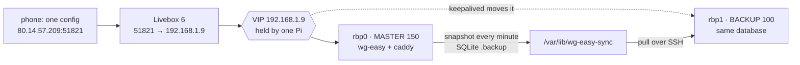

# Edge VPN failover: one config, either Pi — design

**Status:** proposed 2026-11-26 · **Date:** 2026-11-26 · **Board:** homelab, card #888
**Live basis (measured 2026-11-26):** both Pis over SSH — `docker ps`, `wg show`, and the two
`wg-easy.db` files read out of the containers; the router table in
[`docs/audit/livebox-2026-11-26.md`](../../audit/livebox-2026-11-26.md); `ansible/pi/hosts-pi.sh`,
`ansible/playbooks/templates/runners/`; commit `d3066172` for the static WAN address. Every number
below was read from the host it names, not inferred.

## Intent

One client config must keep working when the Pi that issued it dies. Today a config minted on one
host names that host's key and port, so the other host drops it, and losing the right Pi means a
manual restore before anyone can get back in.

Why now: the two panels were just moved behind TLS on each host (commit `a9c5116d`) and sign in with
their own accounts, so their state is worth keeping; the WAN address is fixed, so an endpoint literal
in a config can stay valid; and the reflash campaign will touch both hosts, which is the moment to
make them one pair rather than two look-alikes.

## What exists today

| | `rbp0` | `rbp1` |
|---|---|---|
| OS | Ubuntu 24.04.5 | Ubuntu 22.04.5 |
| Tunnel address / port | `192.168.1.22` / `51821` | `192.168.1.38` / `51822` |
| Server public key | `cE7YgQJqu/3yI/wetWtcM0FyxDZtid69Hg6j9UNrjEk=` | `KYdtmW9s1qMLnOYlKdktbyzOfTQEHYBsZtKvO8VE4xk=` |
| Peers in the panel | `xps15` `10.8.0.3`, `val-phone-perso` `.4`, `val-phone-pro` `.5` | `xps15` `.2`, `phone-perso` `.3`, `phone-pro` `.4`, `elevensky2` `.5` |
| Panel | wg-easy `15.5.0`, caddy `2.11.9`, its own login, `vpn-rbp0.kub.local:8443` | the same, `vpn-rbp1.kub.local:8443` |
| Database | `~/dockers/config/wg-easy.db`, SQLite, journal `delete`, 24 pages, `0600 root` | the same, its own file |
| Container endpoint | `80.14.57.209:51821` | `80.14.57.209:51822` |

The panel's DNS list, read from `user_configs_table` and copied into each client row, is
`192.168.1.38` then `192.168.1.22` on `rbp0` (the reverse on `rbp1`): a config minted on either host
names both Pi-holes, so name resolution outlives the other host dying. The compose file still carries
an `OAUTH_*` block and a `wg-easy.env`; by
[the edge-auth decision](../../decisions/2026-11-26-edge-pis-local-auth-only.md) no provider exists,
sign-in is local, and that secret goes when the file is next touched — which this change is.

The two hosts have different server keys, different peer keys and different client addresses for the
same devices, so the panels are two VPNs that happen to share a subnet. The router's table has one
destination per external port: `51821` → `192.168.1.22`, `51822` → `192.168.1.38`. The WAN address is
static (`d3066172`), and the tunnel port a config dials is the port its issuing panel was configured
with, so the ports are part of the config.

Neither host has `sqlite3`, `keepalived` or an automation account (card #481). `vronteix` is in the
`docker` group on both, so it can read and write the database through `docker exec` without sudo;
that is the only privileged channel the pair already has.

## Goals

- A config issued after this change keeps working when either Pi dies, with no change on the phone at
  failure time.
- The standby answers the tunnel **and** its panel, and shows the same peers as the authority.
- One authoritative panel; when the two disagree, the standby is the one that moves.
- Failure recovery is measured and written down, not assumed; the acceptance test is repeatable.
- Drift is visible: `hosts-pi.sh verify` names it, and a state that is looser than the contract is a
  finding rather than a comment.
- A stopped or diverged sync alerts, rather than waiting for someone to run `verify`.
- `ansible/pi/hosts-pi.sh` and `hack/tests/test_pi_script.py` grow with the change.

## Non-goals

- Active/active or load balancing. One address answers at a time; the other host is warm, not
  serving.
- A single panel URL. `vpn-rbp0` and `vpn-rbp1` stay; during an rbp0 outage the operator uses
  `vpn-rbp1`, which already answers.
- DNS failover. The two Pi-holes already serve both addresses, and nothing here touches DNS.
- Any overlay or mesh (Tailscale, Netbird, Netmaker, Nebula) and any UDP load balancer — see
  Approaches for why they were dropped.
- Router automation. The Livebox's credential is not stored anywhere an agent can reach, so the
  forward change is the operator's step; the design says exactly what it is.
- Reworking the blocklists, the Pi-hole parity, or the TLS setup.

## Constraints

- VRRP needs both hosts on one switched segment. They are: the same `/24`, one switch, no VLAN
  between them.
- An external port has one destination, and the box has no health check. Only an address that moves
  can make one endpoint answer on either host.
- A WireGuard listener is not bound to one address; the compose publishes `51821` on `0.0.0.0`, so an
  address added to `eth0` later is answered with no compose change.
- The database is SQLite in rollback-journal mode (`delete`), written by a Node app. A plain file copy
  taken while a write is in flight can tear; `sqlite3 .backup` is the consistent read.
- wg-easy's image ships no backup command (`cli` has `db:admin:reset`, `clients:list`, `clients:qr`)
  and its SQLite binding is bundled so `require('better-sqlite3')` fails from `/app`. The snapshot has
  to be made by `sqlite3` on the host, which neither host has yet.
- Sessions are bound to the instance that made them: after the address moves, the new host cannot
  decrypt the old session, so the client must handshake again. Defguard's published measurement is
  3–30 s, gated by the client's keepalive; the number here is a measurement, not a promise.
- There is no automation account on either Pi and no passwordless sudo. A host-to-host copy needs its
  own key and its own restricted account.
- The WAN address is static, so `80.14.57.209` can live in configs literally; no dynamic DNS.

## Approaches

Three shapes were considered for the redundancy itself:

1. **A floating address and identical state (VRRP/keepalived).** Two hosts on one segment, one address
   that moves, both holding the same server key and peer set. Active/standby, no extra component,
   nothing to buy. **Chosen.**
2. **A UDP load balancer with sticky routing (Envoy, as Defguard documents).** Gives active/active and
   works where VRRP cannot, but needs a host that is neither Pi; a proxy on one of them is the failure
   it is meant to survive. Dropped.
3. **A mesh or overlay (Tailscale, Netbird, Netmaker).** They add endpoint discovery and relay paths
   precisely because WireGuard has none, but they replace wg-easy, add a control plane and, for the
   hosted ones, a provider. Dropped for this need.

Within the first shape, three smaller forks were settled in conversation:

- **What the standby carries.** The whole wg-easy database on both, one authority (the operator needs
  to log into the standby during an outage) — versus plain WireGuard with no panel, which is less
  state but loses that. **Chosen: the database.**
- **Who copies.** The standby pulls from the authority, so the key and the timer sit on the host that
  only reads. Push needs root on the far side; a manual publish from the laptop has no key but turns a
  forgotten copy into the silent failure this card exists to remove. **Chosen: pull.**
- **The address.** A new address for the pair, versus letting the survivor take over `rbp0`'s own
  `192.168.1.22`. The second avoids a router edit but puts a DHCP-reserved address in two places.
  **Chosen: a new address.**
- **When the two disagree.** Refuse and name the differing rows, versus overwrite silently, versus a
  two-way merge. A row-level merge across sessions and OAuth state is fragile, and silent overwrite
  loses a change made during an outage. **Chosen: refuse and name.**

## Decisions

**D1 — `rbp0` is the authority; `rbp1` conforms.** The same rule as DNS parity: when the two panels
disagree, the standby is the one that moves. Its query and peer history is not merged.

**D2 — both run wg-easy on one database, listening on `51821`.** The per-host port placeholder in the
compose template (`@WG_UDP_PORT@`) becomes a literal, because both hosts now answer the same port.
The router's `51822` forward is deleted with the change; a config that dials it is one of the configs
reissued in D8.

**D3 — keepalived moves one LAN address for the pair.** `192.168.1.9/24` is the provisional value
(the operator confirms it, or names another; it must be free and outside the DHCP pool, which starts
at `.10` in the measured lease list). `rbp0` is `MASTER` at priority 150, `rbp1` is `BACKUP` at 100,
`advert_int 1`, **unicast** peers (each host names the other; no multicast on the house LAN), and
`preempt_delay 300` so a returning `rbp0` does not take the address back in the middle of its boot.
The router forward changes from `192.168.1.22` to this address.

**D4 — the address follows a running tunnel, not just a live host.** A `vrrp_script` checks that the
`wg-easy` container is running; a host whose VPN has crashed releases the address even though
keepalived itself is alive.

**D5 — the endpoint stays one literal.** With one database, both panels issue configs with
`host=80.14.57.209`, `port=51821`. The client endpoint therefore survives a change of hosting Pi, and
the router does the only translation.

**D6 — the authority snapshots its database every minute.** A root systemd timer on `rbp0` runs
`sqlite3 .backup` against the live file, checks `pragma integrity_check`, and atomically renames the
result to `/var/lib/wg-easy-sync/wg-easy.db`, mode `0640`, group `wg-sync`. A snapshot older than a
few minutes is a finding in `verify`.

**D7 — the standby pulls the snapshot and only replaces the database when it changed.** A root timer
on `rbp1`:

1. reads the snapshot over SSH as the `wg-sync` account — a system account, home
   `/var/lib/wg-sync`, `/bin/sh`, no password, no group — whose key line on `rbp0` carries
   `restrict`, `from="192.168.1.38"` and a forced `cat` of that one file, so the account can read the
   snapshot and nothing else;
2. checks integrity, then computes a fingerprint of the peer-bearing tables — `interfaces_table`,
   `clients_table`, `user_configs_table`, `hooks_table` and the non-session columns of
   `users_table`;
3. if the local fingerprint equals the last one it installed, sees the same fingerprint in the
   snapshot, and stops — no restart, no flap;
4. otherwise stops `wg-easy`, installs the snapshot, starts it again, and records the new fingerprint
   in `/var/lib/wg-easy-sync/last-installed`.

A database replacement restarts the standby's panel and resets its login sessions; that is acceptable,
and it happens only when the authority actually changed.

**D8 — a change made on the standby is refused, not erased.** If the local fingerprint differs from
`last-installed`, the copy stops and logs the rows that differ. The operator either re-applies the
change on `rbp0` and forces the next copy, or forces it and loses the change. There is no reverse
channel from `rbp1` to `rbp0`, which keeps the key and the write path one-directional. The single
override is `hosts-pi.sh vpn-sync --force`, run on the standby: it installs the snapshot and records
its fingerprint, so the standby's own edits are what is lost. An absent `last-installed` — a freshly
restored host — is refused the same way, because no copy has been accepted yet; the reflash procedure
runs the forced copy once, after the key is restored and before `verify`, which is also what moves
the container from its restored port to `51821`.

**D9 — the first copy is a migration, once.** `rbp0`'s peer set is the truth. `elevensky2` exists only
on the standby and is added to `rbp0`'s panel before the switch, at the next free address
(`10.8.0.6`); the two phones keep `rbp0`'s addresses and `rbp0`'s names, which the operator confirms.
Each device then imports exactly one config, from `rbp0`, once. After that, a config is never
regenerated for a host change.

**D10 — the pieces are rendered and owned like the rest of the stack.** `ansible/pi/hosts-pi.sh` gains
`render`/`setup`/`verify` for `keepalived.conf`, the snapshot script, the sync script and their two
systemd unit pairs, plus one `vpn-sync --force` path for the forced copy; `setup` installs
`keepalived` and `sqlite3` from Ubuntu, creates the `wg-sync` account on both hosts, and refuses to
run when the key material is absent — it never invents a secret, the same rule `pihole.env` follows.

**D10a — one key pair, two files, both in the backup.** The private half lives at
`/etc/wg-sync/id_ed25519` on `rbp1` (`0600 root`); the public half is one line in
`/var/lib/wg-sync/.ssh/authorized_keys` on `rbp0`, with `restrict`, `from="192.168.1.38"` and the
forced `cat` above. The key is minted once by the operator and the reflash procedure restores it:
`backup`/`restore` grow both paths, which is the same class of secret as the `wg-easy.db` and
`pihole.env` the backup already carries. `setup` and `verify` name a missing half instead of writing
one.

**D10b — the unused OIDC block goes with this change.** The compose file is edited here anyway, and
[the edge-auth decision](../../decisions/2026-11-26-edge-pis-local-auth-only.md) says the `OAUTH_*`
block and `wg-easy.env` go when the file is next touched: no provider exists and the sign-in is
local. The `require_env` check for that file, the README's list and the test that names it shrink with
it.

**D11 — the firewall learns a protocol, and the rule shape grows with it.** VRRP is IP protocol 112
with no port, so `ufw` names it `proto vrrp`, not a port: a `112/udp` rule would match nothing and
still read as protection, and the default deny would drop every advertisement. Both rule records —
`ansible/roles/firewall/vars/main.yml` with `tasks/resolve.yml`, and `hosts-pi.sh`'s
`firewall_rule_table`/`ufw_rule_line` — gain a port-less rule shape, one rule per peer address, in
both directions, and the string-building parity test grows the same shape. The tunnel port needs
nothing: a published container port is DNAT'd and never reaches `ufw`'s INPUT chain.

**D12 — recovery is measured, not assumed, and the client is configured to make it fast.** The
protocol retries a handshake 15 s after data goes unanswered (`KEEPALIVE_TIMEOUT` 10 s +
`REKEY_TIMEOUT` 5 s), and an idle client only starts that clock at its next keepalive. The panel's
default `PersistentKeepalive` therefore goes from 25 s to 10 s **before** the one-time reissue, so an
idle tunnel recovers in roughly 15–25 s. The acceptance criterion becomes "in use ≤15 s, idle ≤30 s"
instead of the card's 10 s, which sits below the protocol's floor. The test stops keepalived on the
holder, times a client in use and an idle one, and records both in the runbook.

**D13 — a stopped sync is visible, not silent.** node-exporter on both Pis gains the textfile
collector pointed at `/var/lib/node-exporter/textfile` (the `/:/host` mount the container already
has), and each script writes one file atomically, `0644` so the container's `nobody` can read it:

| file | series |
|---|---|
| `wg-vpn-snapshot.prom` on `rbp0` | `wg_vpn_snapshot_age_seconds`, `wg_vpn_snapshot_ok` |
| `wg-vpn-sync.prom` on `rbp1` | `wg_vpn_sync_age_seconds`, `wg_vpn_sync_ok`, `wg_vpn_sync_diverged` |
| `wg-vpn-vrrp.prom` on both | `wg_vpn_vrrp_master` — 1 on the holder, 0 on the backup, written by a keepalived notify script |

Four rules are created through Grafana's API, because they live in its database and not in git:
`EdgeVpnSnapshotStale` (`wg_vpn_snapshot_age_seconds > 600`, warning),
`EdgeVpnStandbyStale` (`wg_vpn_sync_age_seconds > 600 and wg_vpn_vrrp_master == 0`, warning — the
standby is stale while it is the backup; a backup that has taken over is allowed to be behind),
`EdgeVpnSyncDiverged` (`wg_vpn_sync_diverged == 1`, warning) and `EdgeVpnAddressUnheld`
(`sum(wg_vpn_vrrp_master) < 1`, critical — neither host holds the address). They join the
`homelab-core` group at 300 s with `for: 10m`, like the other staleness rules, and no data is treated
as the failure, the same pattern the restore-drill rules use. `docs/reference/alerts.md` gains the
four rows. No dashboard: these numbers are for the rules.

## How it works

A failure, in order: the holder stops advertising (power, kernel, or the `wg-easy` check fails);
the backup promotes after about three advertisement intervals and answers ARP for the address; the
router's existing NAT entry still points at the address, so packets arrive at the new holder; the
client's session is unknown there, its next packet goes unanswered, and it handshakes again. Nothing
on the phone changes, and nothing is run by hand.

A return: the old holder comes back as `BACKUP`, waits `preempt_delay` seconds, and takes the
address back with one rehandshake. The database it carries is the authority's, so no copy is needed
on the way back.

## What this changes in the repository

| Path | Change |
|---|---|
| `ansible/pi/hosts-pi.sh` | install/render/verify for the new pieces; the `wg-sync` account; the two unit pairs; `vpn-sync --force`; `backup`/`restore` grow the key paths |
| `ansible/playbooks/templates/runners/docker-compose.yml` | the tunnel port becomes a literal `51821`; the unused `OAUTH_*` block and the `wg-easy.env` env_file go; node-exporter gains the textfile directory |
| `ansible/playbooks/templates/runners/keepalived.conf` | new: one instance, unicast peers, priorities, `vrrp_script`, notify script |
| `ansible/playbooks/templates/runners/wg-vrrp-notify.sh` | new: writes `wg_vpn_vrrp_master` on a transition |
| `ansible/playbooks/templates/runners/wg-snapshot.sh` | new: `.backup`, integrity check, atomic rename, snapshot metrics |
| `ansible/playbooks/templates/runners/wg-sync.sh` | new: pull, fingerprint, refuse, replace, restart, sync metrics |
| `ansible/playbooks/templates/runners/systemd/` | new: the two unit pairs |
| `ansible/roles/firewall/vars/main.yml` + `tasks/resolve.yml` | a port-less `proto vrrp` rule shape, both records |
| `ansible/pi/README.md` | the pair, the authority rule, the key, the verification; one secret fewer |
| `docs/how-it-works/network.md` | `51821` → the new address; `51822` gone |
| `docs/runbooks/pi-reflash.md` | the sync key after a reflash; the forced first copy; the port |
| `docs/runbooks/edge-vpn-failover.md` + `mkdocs.yml` | new: the failover test, the divergence recovery, the address check |
| `docs/reference/alerts.md` | the four new rules and their no-data behaviour |
| `docs/reference/metrics.md` | the three textfile families and the collector on the Pis |
| wg-easy panel (live) | the default keepalive 25 s → 10 s, before the one-time reissue |
| Grafana (live) | the four rules, created through the API with `GRAFANA_TOKEN`, not in git |
| `hack/tests/test_pi_script.py` | the render, the units, the port, the divergence path, the port-less rule shape |

## Rollout order

1. Confirm the address and the DHCP pool; mint the sync key and put each half in place; add
   `elevensky2` to `rbp0`'s panel; reissue one config per device from `rbp0` and import it.
2. Merge the change, then run `setup` and `verify` on `rbp0`, then on `rbp1`. `rbp0` takes the
   address first; `rbp1` joins as backup.
3. Run the forced first copy on `rbp1` (`vpn-sync --force`), then `verify`: it moves the container
   from its restored port to `51821` and records the fingerprint.
4. Confirm the two panels show the same peers and the same endpoint.
5. On the router: point the `51821` forward at the new address and delete the `51822` rule. This is
   the operator's step.
6. Create the four alert rules through Grafana's API and confirm they evaluate against the new series
   (no data before the timers have run reads as Alerting, which is the intended failure state).
7. Run the acceptance test from a client that dials `80.14.57.209:51821` through the box (hairpin
   works from the LAN), record the active and idle recovery times.

## Risks, and what the builder decides

- **The router step is the only one that cannot be checked from a Pi.** Until it is applied, the
  address moves but the public port still lands on `rbp0`. The runbook states the expected table and
  the test that proves it.
- **A split brain is not possible on one switch**: a host that cannot hear its peer cannot reach the
  router either. If the LAN is ever segmented, this assumption has to be re-examined.
- **The same server key on two hosts** means a LAN client that dials a Pi's own address bypasses the
  address the pair agrees on. Only the shared address is supported; the runbook says so.
- **A database replacement resets the standby's login sessions**, so the operator signs in again after
  a sync that changed anything. Only a real change triggers it.
- **The sync key is a new credential.** It is one-directional, restricted to one file, on its own
  account, and both `setup` and `verify` refuse when a half is missing. `backup`/`restore` carry it, so
  a reflash keeps it; a lost key fails the timer visibly rather than silently.
- **If `rbp0` is lost for good**, `rbp1` holds the newest database and the tunnel; a rebuilt `rbp0`
  restores from the backup or from the standby by hand. The policy is not symmetric: the design
  assumes the authority returns.
- **The 10 s target sits below the protocol's floor.** The session cannot move with the address, so
  every failover costs one handshake, and the client only starts it 15 s after its data goes
  unanswered (plus its keepalive interval when idle). The runbook records what was measured; the card's
  criterion may need to say 15–30 s.
- **A restored standby listens on its old port until the forced copy runs**, because the restored
  database still says `51822` while the compose now publishes `51821`. The reflash order puts the
  forced copy before `verify` for that reason.
- **The metrics only exist once each timer has run**, so before the first run the rules see no data.
  They treat no data as the failure, which is the restore-drill pattern: a quiet zero would hide the
  very case they exist for.
- **The rules live in Grafana's database, not in git.** They survive a restart but not a restore from
  an older database; `docs/reference/alerts.md` is the record they are re-created from.
- **The provisional address** `192.168.1.9` is a call for the operator to confirm against the box's
  pool and any static device.
- Exact SQL for the fingerprint, the unit names and hardening, the `preempt_delay` value, and the
  wording in `ansible/pi/README.md` and the runbook are the builder's calls.
